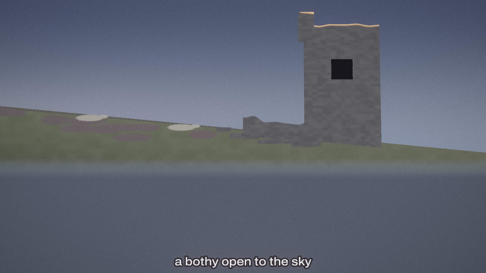
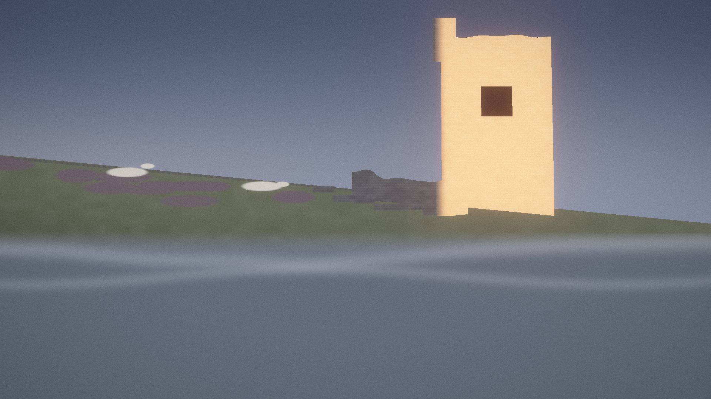
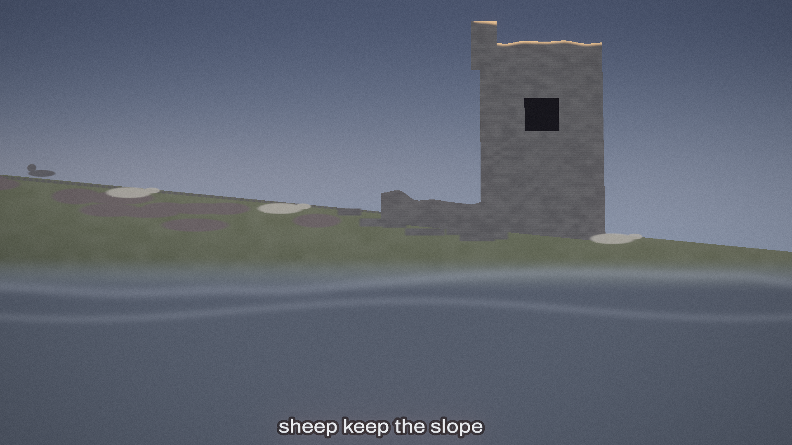
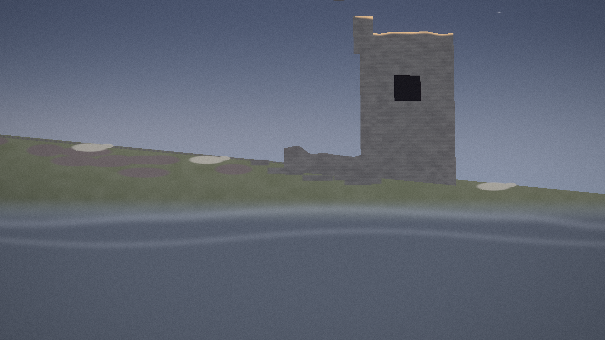

# brokendale — storyboard

| t | beat | frame |
|---|------|-------|
| 0–3.0 | still ruin: gable rim-lit, mist band low, sheep grazing |  |
| 3.5–5.5 | near sheep lifts its head; "baa" mark |  |
| 6–10 | gust stirs heather; hare bounds; far sheep walks past the ruin |  |
| 10.5–15 | curlew crosses the valley; raven circles the chimney; star appears |  |
| 15.5–18 | settle: rim still warm, mist keeps drifting | — |

Probe: `{graze, hare, settle}` phase bits for headless tooling.

Don't forget to ground yourself when its time USE THE SKILL and REREAD IT ALL
