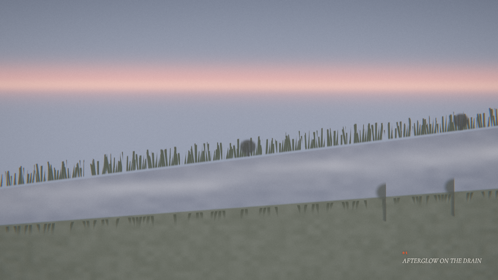
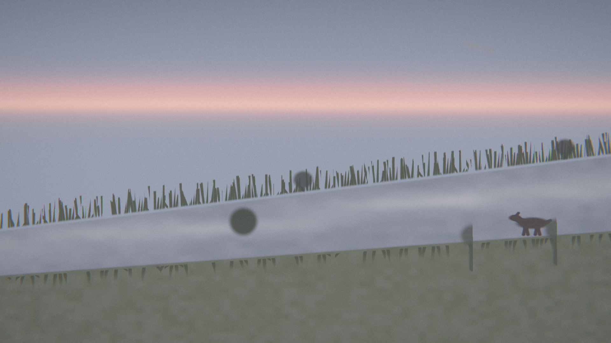
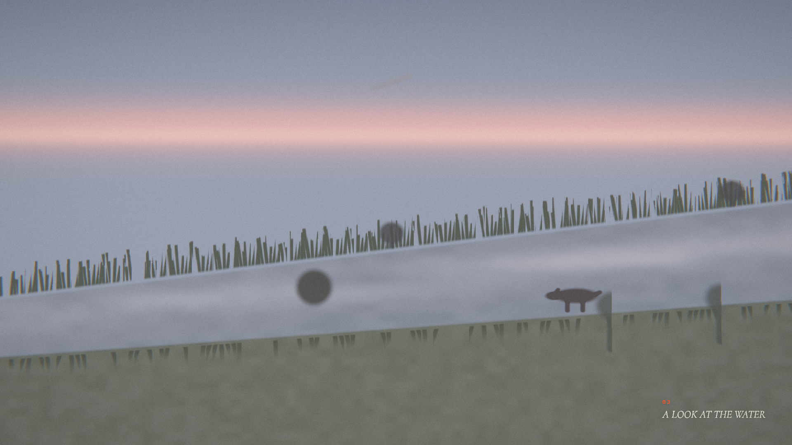
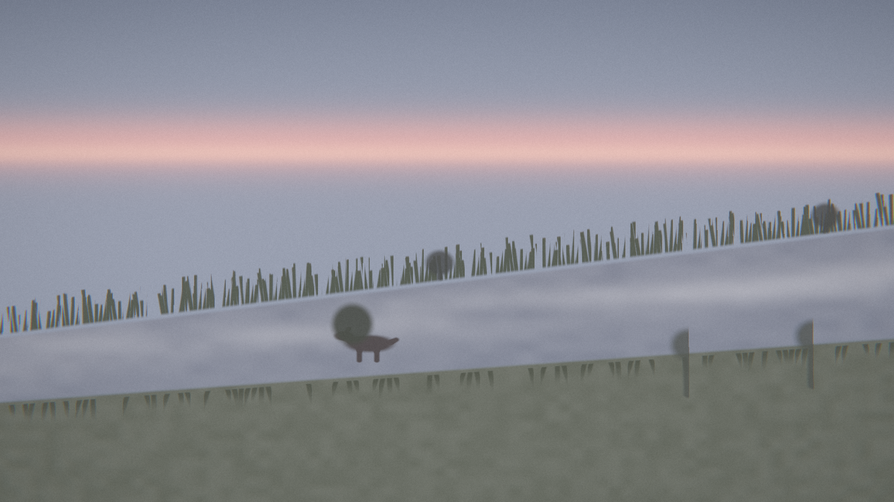

# fenrunner — storyboard

20 s @ 60 fps, 16:9. Four acts (project.json). Stills below.

## Act 1 — AFTERGLOW ON THE DRAIN (0.0–3.0)
Still fen: rose strip on the horizon, pale water ribbon, mist sheet, reed
banks dark. t=1.5 establishes.

## Act 2 — THE BANK RUNNER (3.0–9.5)
Deer trots in from the right along the near bank; reed gust ~6 s; fish rings
~8 s; owl quarters the back sky. t=6.5 mid-trot.

## Act 3 — A LOOK AT THE WATER (9.5–13.0)
The deer stops, head down to the drain; moorhen starts its crossing at 12 s.
t=11.0 is the look.

## Act 4 — GONE BEHIND THE WILLOW (13.0–20.0)
Deer slips behind the willow clump; the star comes out; mist keeps drifting.
t=17.5 settle.

