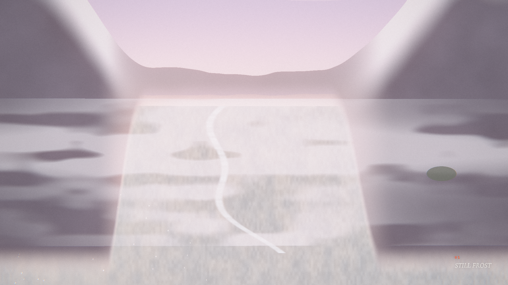
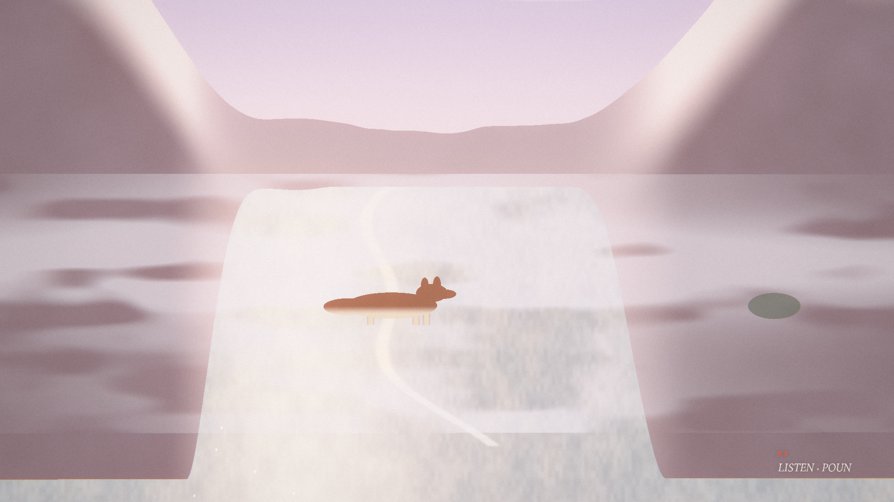
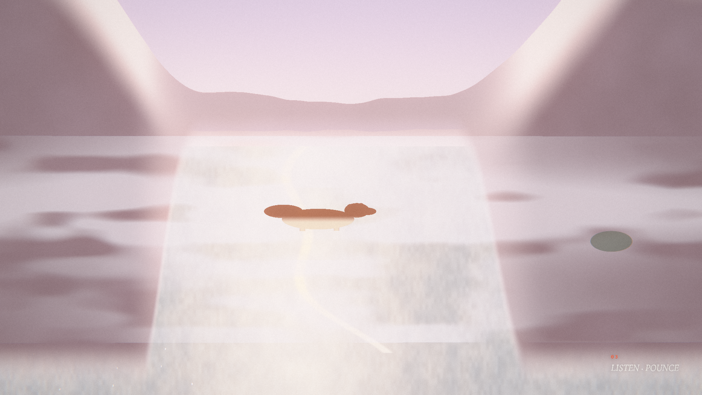
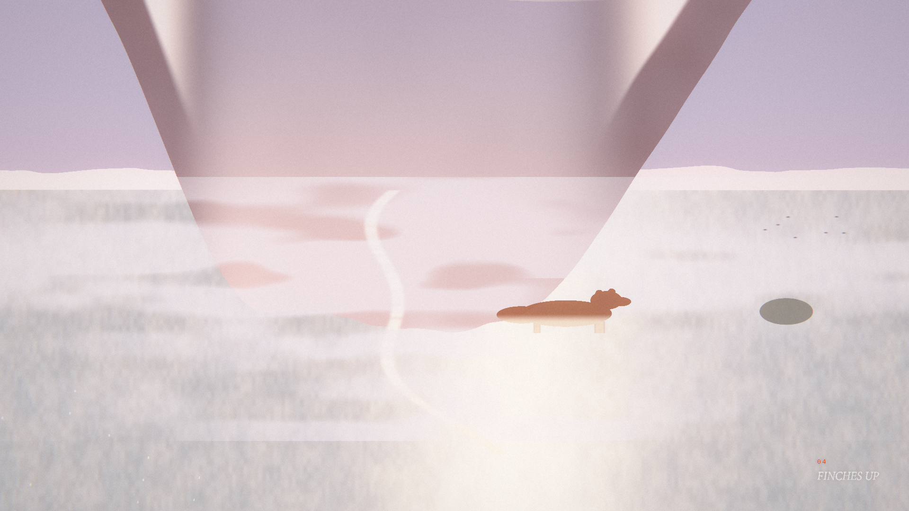
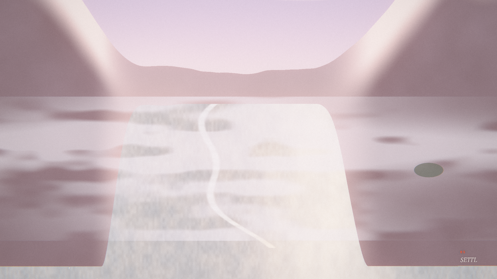

# frostvalley — storyboard (20 s)

## Act 1 · STILL FROST (0.0–3.0)
Cold valley. Walls dark, snow caps just beginning to catch pink. Sun-glitter
band enters the meadow from the left; mist sits still along the stream.
`uDawn` 0→~0.7, `uBand` sweeping. No fox yet (uFx off-screen left).

## Act 2 · FOX ENTERS (3.0–8.0)
Fox trots in from the left edge at a steady gait (x −0.14→0.44), trot bob +
alternating legs; mist corridor opens ahead of it. Glitter keeps sweeping.

## Act 3 · LISTEN · POUNCE (8.0–12.5)
8–10 s: the fox halts mid-meadow — ears stretch tall (`uListen`), head cocks,
legs still. ~10–11.3 s: one pounce — front end dips and rises in a hop arc
(`pounceU`), tail tips up, front legs tuck. Then settles and resumes.

## Act 4 · FINCHES UP (12.5–16.5)
Fox trots on toward the right edge. At 13.1 s seven seeded finches erupt from
the far-right bush in a dispersing fan, wings fluttering, ~2 s window.

## Act 5 · SETTLE (16.5–20.0)
Fox exits right (`uFx` > 1.07 → gated off). A raven makes one high slow
circle over the valley throat (`uRaven` 15.5→19.5). Glitter band reaches the
meadow's right side; mist re-pools behind the fox's passing. Still frost again.

## Camera
Near-static low tracking — a soft ±0.8 drift following the fox, small push-in
over the pounce. Probes: `fox` (tracks `foxX/foxY`), `sun band` (tracks `uBand`).

## Stills (embedded verification)

- t=1.5 — still frost: walls + headwall, glitter lane entering, mist along the stream
- t=9.0 — listen: ears tall, gait stopped mid-meadow
- t=10.6 — pounce: crouch/hop with tail tipped
- t=13.8 — finch burst from the far-right bush, fox trotting on
- t=17.5 — settle: fox gone, glitter lane on the right, raven circling high

