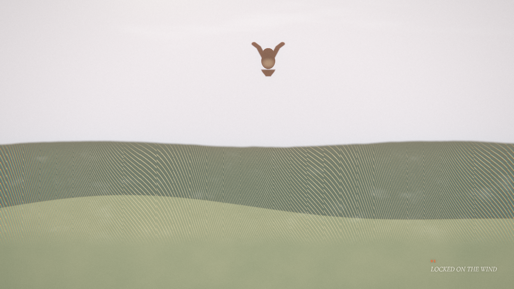
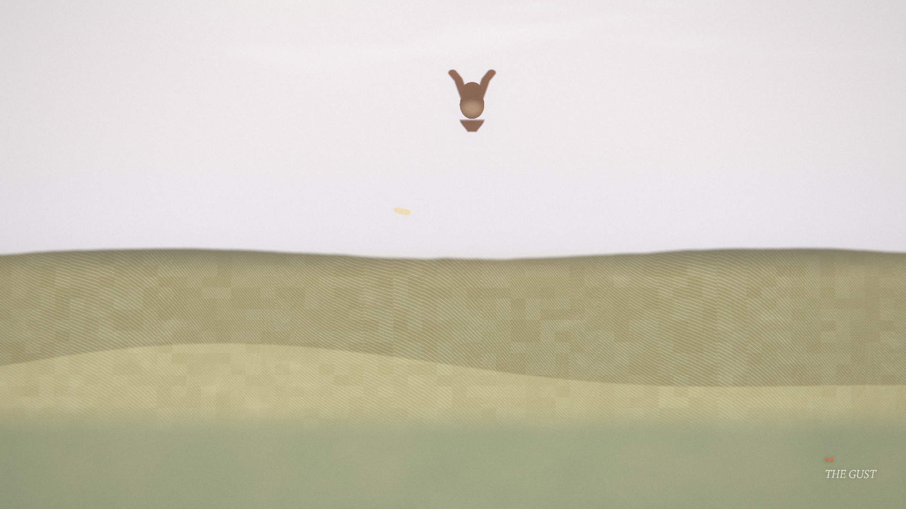
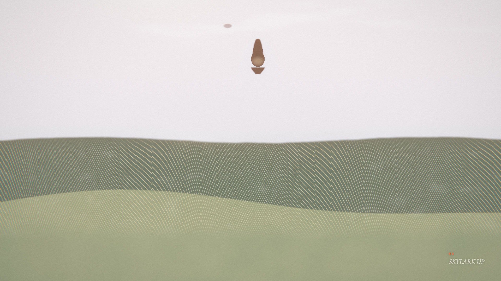
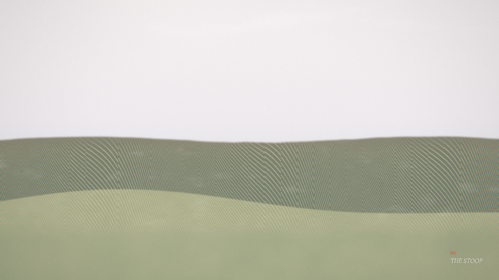
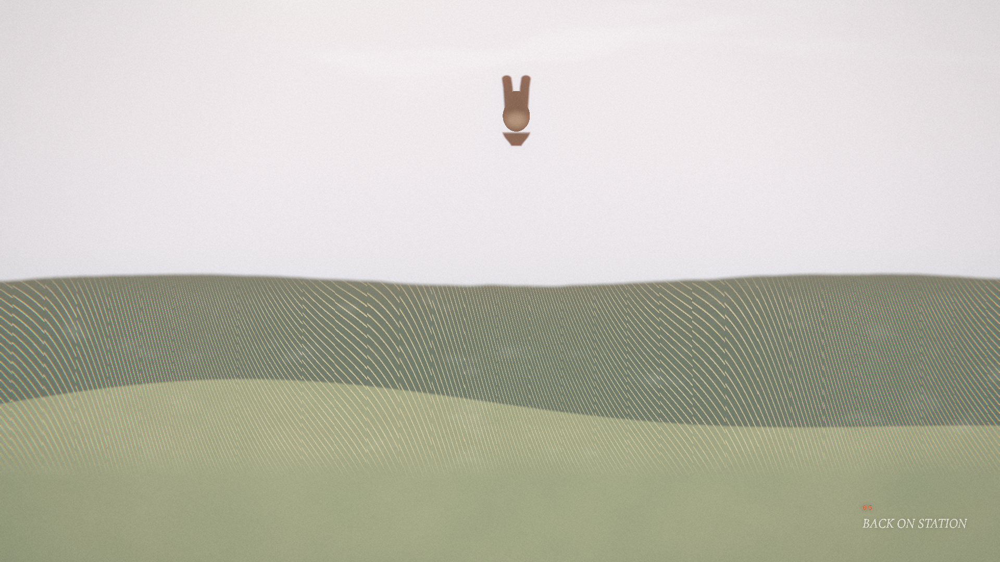

# Kestrel Hover — storyboard

20s @ 60fps, single backdrop pass, kestrel compositional center throughout.

## Act 1 — LOCKED ON THE WIND (0–4.5)
Hover steady above the verge; grass ambient lean; first drop-and-rise dip at ~4s.

## Act 2 — THE GUST (4.5–8.5)
Grass flattens right; a straw fragment crosses frame; rabbit ears flash once.

## Act 3 — SKYLARK UP (8.5–12.5)
Skylark vertical from the verge, flutters, levels and exits right; second dip ~11s;
dust puff rolls the hedge.

## Act 4 — THE STOOP (12.5–16.8)
Wings fold, kestrel dives off bottom-right over ~0.9s; glides back in from
upper-left.

## Act 5 — BACK ON STATION (16.8–20)
Hover resumed, verge settling to ambient lean; halo steady.

