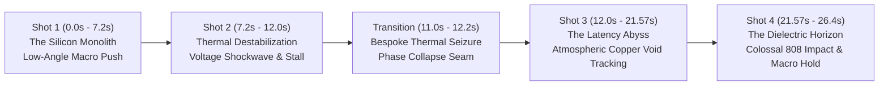

# Storyboard & Spatial Blocking: 'The Memory Singularity'
*Flagship Viopls Video Essay Chapter — 26.4s Multi-Stage Audiovisual Sequence*

---

## 1. Sequence Progression & Timeline Architecture

- **Total Duration**: 26.40 seconds (1,584 frames @ 60.0 fps CFR)
- **Soundtrack Sync**: Lorn — *Anvil* (Master Transient Lock, 100.16 BPM)
- **Downbeat Anchors**:
  - $0.00\text{s}$ (Intro / Establishing Macro Push)
  - $4.80\text{s}$ (Camera Crest / Monolith Crevice Reveal)
  - $9.59\text{s}$ (Voltage Surges / Circuit Destabilization)
  - $11.99\text{s}$ (**DOWNBEAT 5 SEAM: Thermal Seizure / Phase Collapse Transition**)
  - $16.78\text{s}$ (Latency Abyss Wide Tracking / Time Dilation)
  - $19.17\text{s}$ (Pre-Drop Silence Vacuum / Tape Flutter)
  - $21.57\text{s}$ (**DOWNBEAT 9 CLIMAX: Colossal Dielectric Horizon Impact**)
  - $26.40\text{s}$ (Residual Sub Dissipation / Macro DoF Hold)

---

## 2. Multi-Shot Breakdown

### Shot 1: The Silicon Monolith (0.00s – 7.20s)
- **Scale**: Macro-to-Medium Wide ($1080\text{p}$, $32\text{mm}$ anamorphic equivalent).
- **Camera Vector**: Starts low at $(0.0, 0.45, 5.2)$ looking forward through a canyon of tiered silicon wafers; dollies forward smoothly to $(0.0, 1.10, 1.4)$.
- **Kinetic Action**: Thousands of optical circuit channels pulsing with coherent light. 25,000 convective thermal embers floating upward through cryogenic vapor channels.
- **Audio Anchor**: Rhythmic tape-distorted synth pulses + 52Hz conduit thrum.

### Shot 2: Thermal Destabilization (7.20s – 12.00s)
- **Scale**: Medium Close-Up ($50\text{mm}$ equivalent).
- **Camera Vector**: Pivots slightly off-axis to $(1.20, 1.40, 1.80)$, framing the central processing core and cantilever header beam.
- **Kinetic Action**: Light pulses begin stuttering at $9.59\text{s}$; voltage surge causes blinding red thermal emission spikes (`#FF2A1F`). At $11.986\text{s}$, the phase collapse strikes: tectonic silicon blocks shear with physical spring overshoot.
- **Audio Anchor**: Swelling distortion buildup $\rightarrow$ violent cryogenic rupture sound hit on downbeat $11.986\text{s}$.

### Transition: `thermal_seizure` (11.00s – 12.20s)
- **Mechanics**: Bespoke optical phase collapse shader. Searing chromatic aberration radial spike, whiteout heat bloom, and camera violent impulse tremor ($V_{\text{hit}}$), pulling visual momentum seamlessly into Scene 2.

### Shot 3: The Latency Abyss (12.00s – 21.57s)
- **Scale**: Extreme Wide Chase ($24\text{mm}$ equivalent) to Suspended Tracking.
- **Camera Vector**: Tracks from $(0.0, 1.80, 8.5)$ down a deep subterranean canyon of mirror-polished copper bus conductors.
- **Kinetic Action**: Deep atmospheric fog and 35,000 streaming streak particles. A high-energy charge packet crawls with agonizing, time-dilated slowness across the cold copper trace.
- **Audio Anchor**: Time-dilated, eerie atmospheric soundscape; pre-drop vacuum suction from $19.17\text{s}$ to $21.57\text{s}$.

### Shot 4: The Dielectric Horizon (21.57s – 26.40s)
- **Scale**: Extreme Close-Up Macro ($85\text{mm}$ macro equivalent, $f/22.0$ DoF).
- **Camera Vector**: Snaps forward to $(0.25, 0.95, -17.2)$ looking at terminal plate at $z = -18.5\text{m}$.
- **Kinetic Action**: Downbeat $21.57\text{s}$ impact! The colossal DRAM crystal dielectric wall absorbs the charge with an overwhelming electromagnetic pulse; diegetic text `THE MEMORY WALL // 100ns LATENCY ABYSS` stamps physically into the crystal. Thin-lens DoF rack-focuses onto the etched letters.
- **Audio Anchor**: Earth-shattering 808 sub-bass drop + crystal shimmer resonance decaying over $4.8\text{s}$.

---

## 3. 180° Spatial Axis & Screen Geography

- **Primary Axis of Motion**: Strictly along $-Z$ (forward through the computational pipeline).
- **Camera Screen Geography**:
  - The silicon compute origin sits at $+Z$ looking toward $-Z$.
  - The latency transit corridor travels forward into $-Z$.
  - The memory horizon terminal terminates at $z = -18.5\text{m}$.
- **Zero Vector Inversions**: Camera never crosses the $180^\circ$ line, preserving absolute cognitive continuity for the viewer.

---

## Grounding Yourself
Don't forget to ground yourself when its time USE THE SKILL and REREAD IT ALL
