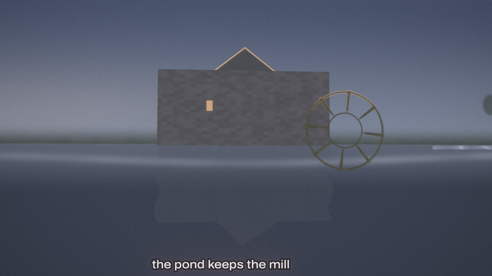
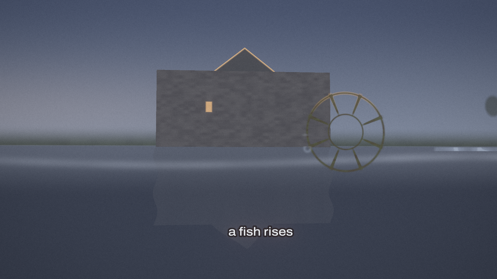
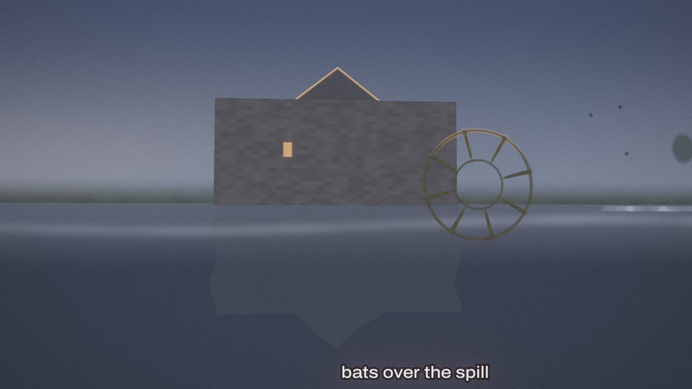
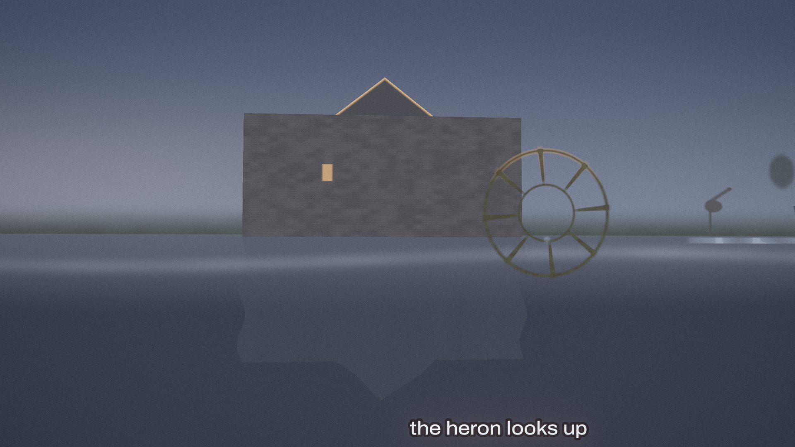

# millpond — storyboard

| t | beat | frame |
|---|------|-------|
| 0–3.0 | still mill: rim-lit gable, wheel dripping, mist on the pond |  |
| 6.0–7.2 | fish rise near the wheel |  |
| 7.5–10.9 | bats dart over the spill |  |
| 10.5–12.6 | heron stands on the spill edge, turns its head |  |
| 13.0–18 | kingfisher dart, water rat, dusk settles on the wheel | — |

Probe: `{wheel, bats, settle}` phase bits for headless tooling.

Don't forget to ground yourself when its time USE THE SKILL and REREAD IT ALL
