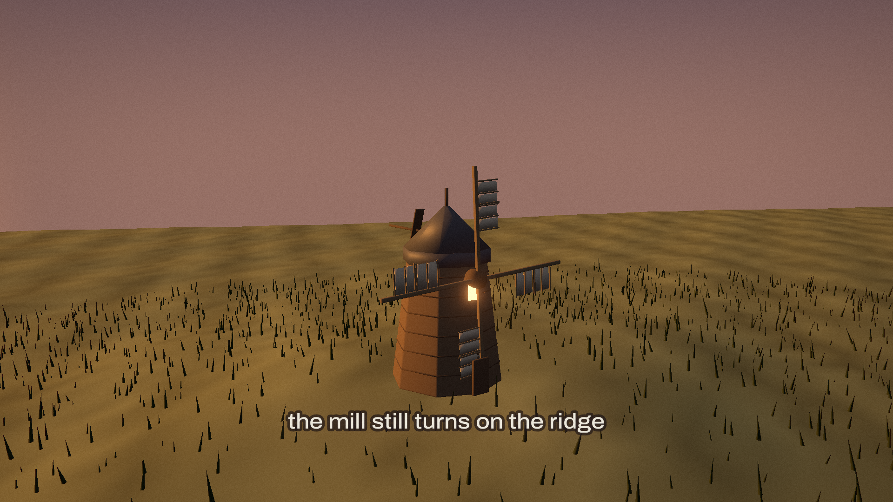
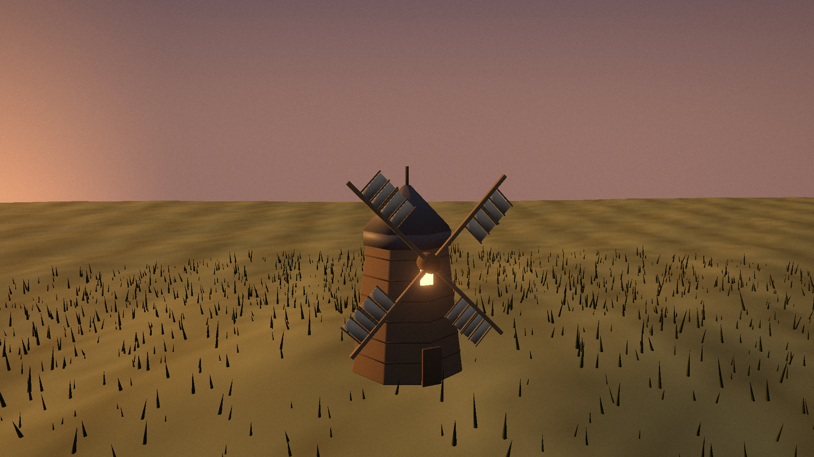
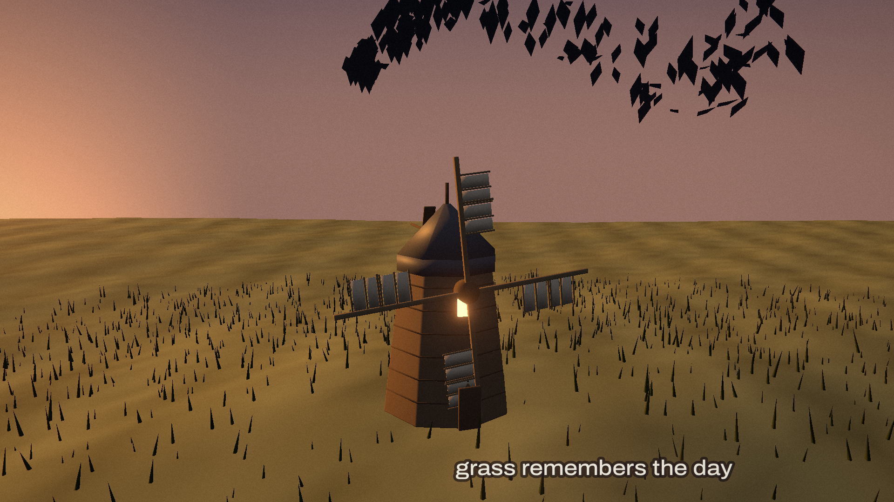
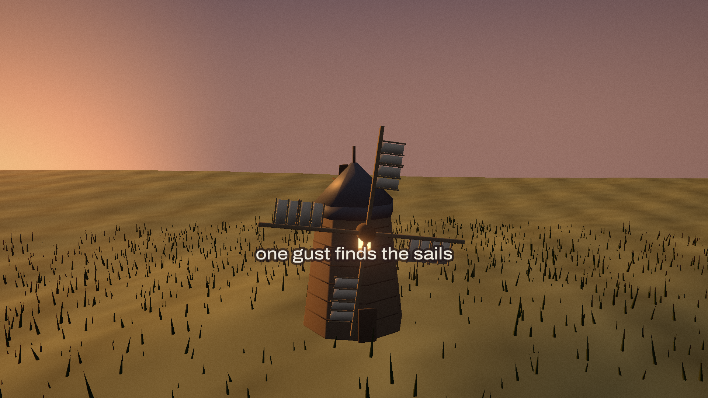

# storyboard — millridget

## Frame map (t, camera, what's in frame)

- **t=0–3** — orbit drift begins, mill centered, sails turning slowly. No flock yet.
- **t=6–12.5** — starling murmuration crosses left→right, high above the mill.
- **t=11.5–13** — gust envelope: sails visibly accelerate for a beat.
- **t=15–18** — light settles; flock gone; mill and ridge in late light.

## Stills

| t | Frame |
|---|-------|
| 2.0 | Mill on the ridge, sails mid-turn, raking shadow |
| 7.5 | Flock entering frame right-of-left, mill steady |
| 9.6 | Murmuration ribbon overhead, mill below |
| 11.9 | Gust beat — sails leant into the wind |
| 17.0 | Dusk settle — warm window, cool field |

## Camera

CameraRig orbit: yaw drifts `-0.35 + t*0.035` rad, radius eases 24→20.5m over the
shot, small settle bob late. Target held on the mill's cap. 42mm lens — the mill
stays mid-frame the whole pass.

## Assets

`assets/mill/model.glb` — Blender-built smock mill (body, cap, sails, tail pole,
door, emissive window). `manifest.json` declares `sails/body/cap` parts.

// Don't forget to ground yourself when its time USE THE SKILL and REREAD IT ALL
