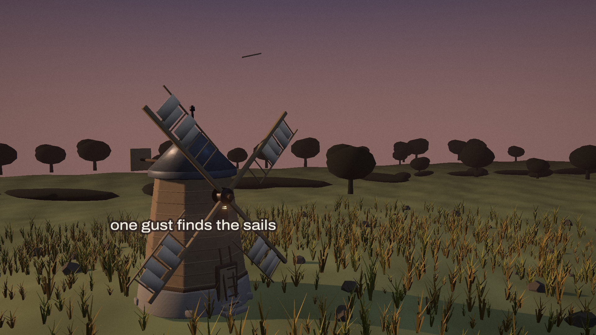
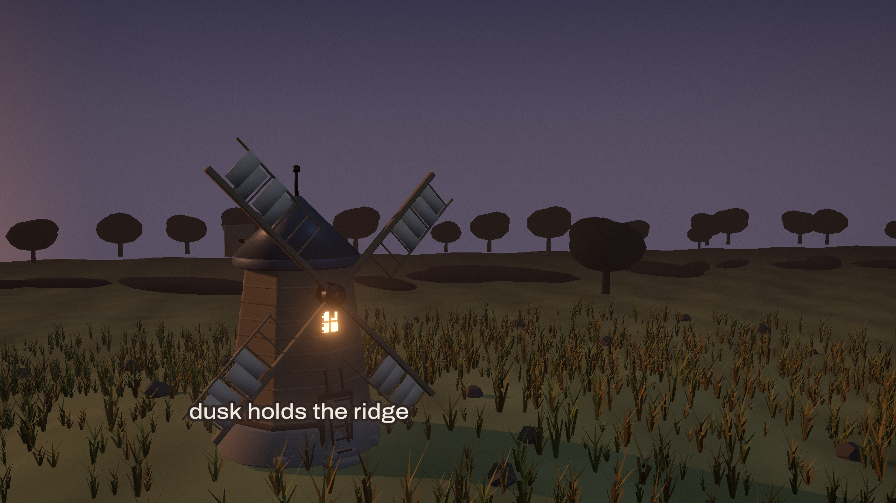

# storyboard — millridget

## Frame map (t, camera, what's in frame)

- **t=0–3** — orbit drift begins, mill centered, sails turning slowly. No flock yet.
- **t=6–12.5** — starling murmuration crosses left→right, high above the mill.
- **t=11.5–13** — gust envelope: sails visibly accelerate for a beat.
- **t=15–18** — light settles; flock gone; mill and ridge in late light.

## Stills

| t | Frame |
|---|-------|
| 2.0 | Mill on the left third, sails mid-turn, raking shadow across the wheat |
| 9.6 | Murmuration ribbon crossing overhead, mill below |
| 12.5 | Gust beat — sails swung further around, window glowing |
| 17.0 | Dusk settle — cooled sky, warm window against the dark field |

## Camera

CameraRig orbit: yaw drifts `-0.55 + t*0.030` rad, radius eases 21→18.5m over the
shot. Target offset right of the mill so it holds on the left third; low eye,
40mm lens looking slightly up.

## Assets

`assets/mill/model.glb` — Blender-built smock mill (body, cap, sails, tail pole,
door, emissive window). `manifest.json` declares `sails/body/cap` parts.

// Don't forget to ground yourself when its time USE THE SKILL and REREAD IT ALL
