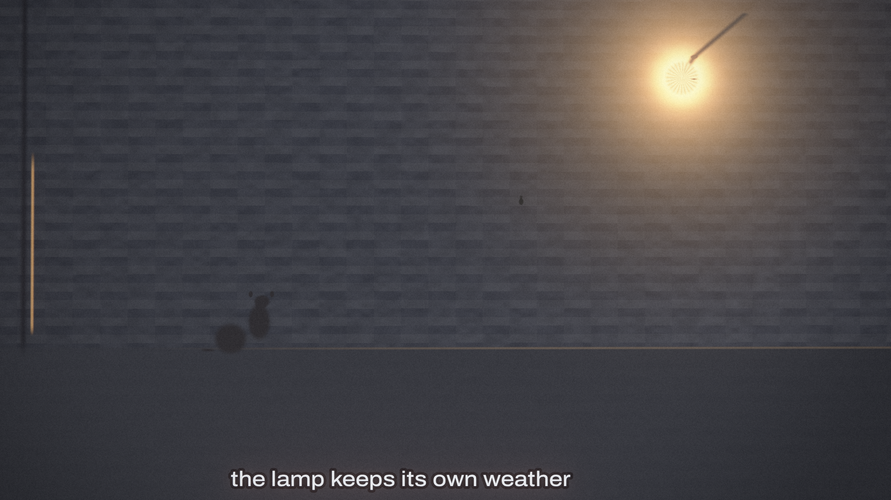
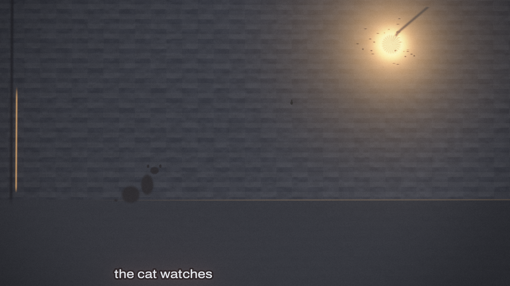
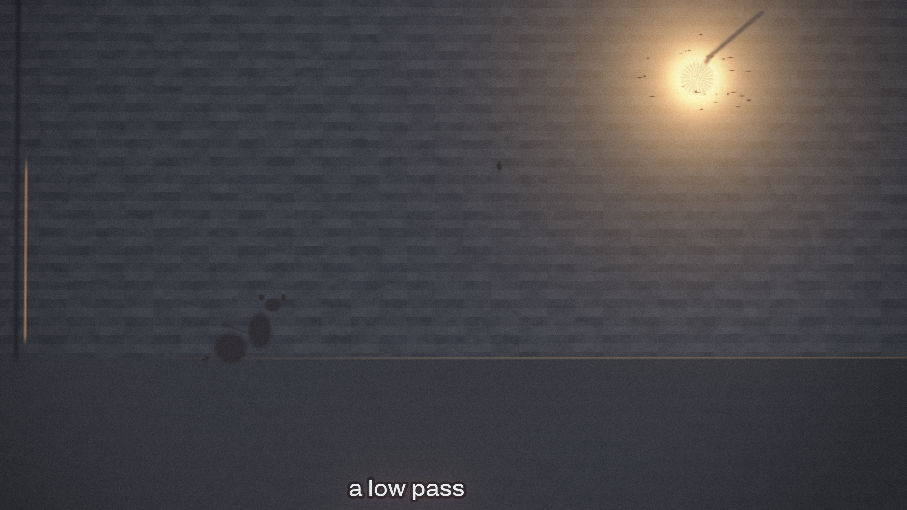
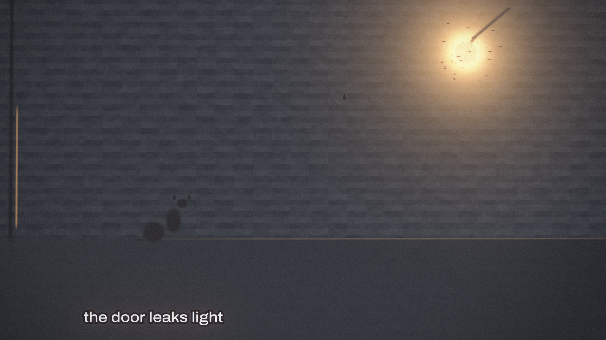

# porchlight — storyboard

| t | beat | frame |
|---|------|-------|
| 0–2.8 | quiet lamp, swarm gathering, cat below |  |
| 4–7 | swarm thickens; the cat tracks the nearest moth |  |
| 8.4–9.1 | low pass — the paw swipe |  |
| 11.5–14.8 | stray moth to the door crack, spider drops |  |
| 16–18 | settle — swarm thins, cat stills | — |

Probe: `{swarm, swipe, settle}` phase bits for headless tooling.

Don't forget to ground yourself when its time USE THE SKILL and REREAD IT ALL
