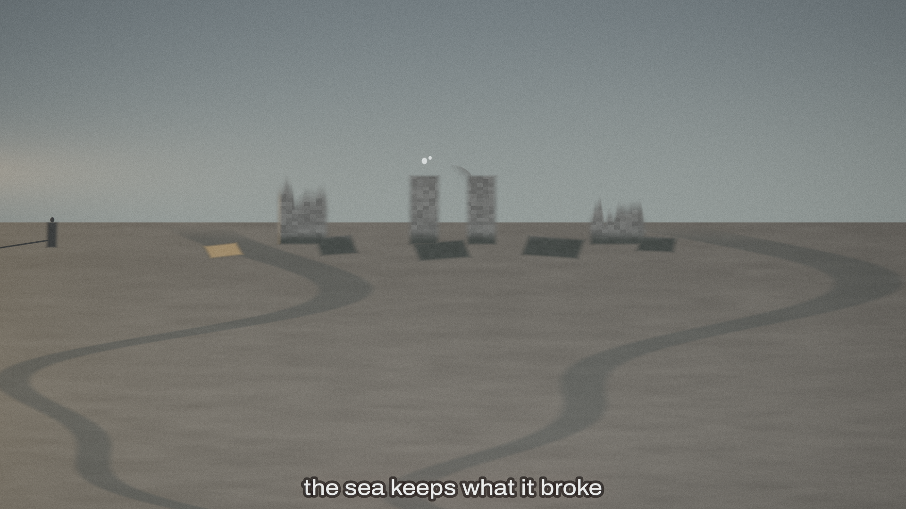
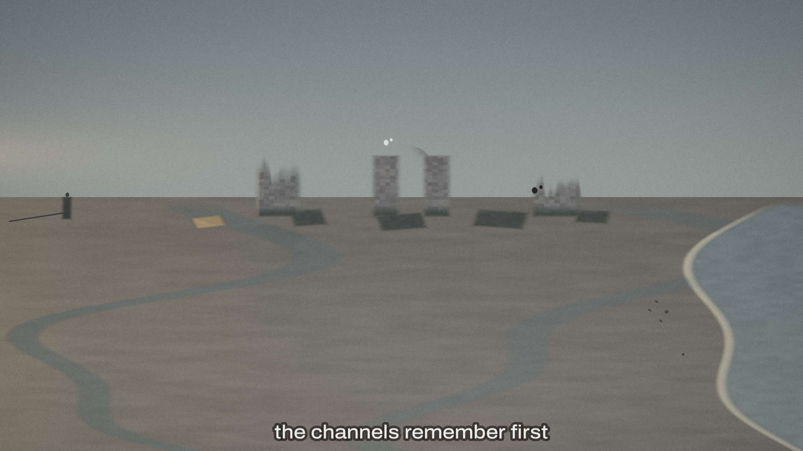
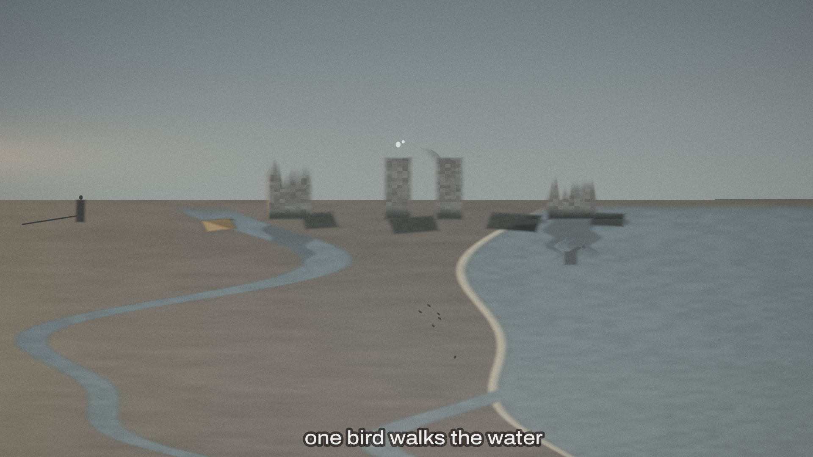
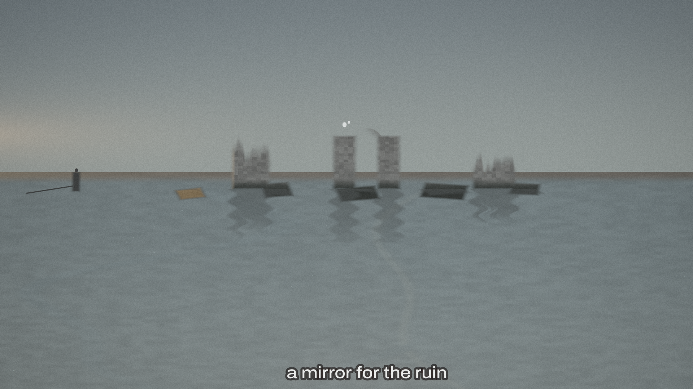

# tidalruin — visual plan

The broken remains of a sea-washed fort standing on a wide tidal flat. The
scene's engine is a single advancing waterline that sweeps the frame
right-to-left: channels fill first, wet sand glosses over, the ruin's mirror
assembles underneath it, and the flat settles into a sheet. All life is
scheduled against that front — sanderlings flee just ahead of it, the heron
fishes the channel it fills, the crow visits a block it will soon cover.

## Concept mapping

| spec element | shader realisation |
| --- | --- |
| wet mirror sand | `sandAt` — fbm ripples + raking-sun sheen toward the left |
| winding shallow channels | `channelAt` — two meandering `sin` seams widening seaward, glassy when the tide finds them |
| partial arch | `archAt` — two legs + broken ellipse ring, crown bitten off upper-right |
| two tower stumps | `towersAt` — tapered boxes with ragged `vn2` tops |
| collapsed blocks | `blocksAt` — 5 seeded tilted slabs scattered at the ruin's feet |
| pale grey-green sky | `skyAt` — desaturated gradient + warm smear low left (raking sun) |
| sea horizon band | `seaAt` — thin darker band under the sky, faint white-crest stripes |
| advancing waterline | `wlX(t)` — closed-form sweep 1.18→0.56 over `WATER_IN→COVER`, wavy front + glow + foam flecks |
| covering shallow / mirror | `cov` gate → `waterColAt` sheen + ruin flipped about `RUIN_BASE` with `sin` shimmer |
| barnacle-dark bases | `ruinColAt` — `barn` band + `cov`-driven wet darkening at the waterline |
| gull on the arch | pale speck + head dot perched on the crown's unbroken side |
| crow on a fallen block | dark silhouette + hop arc at `CROW+2.6s` |
| fisherman | far-left figure silhouette + `dseg` dragged line, slow drift |
| heron | walk → freeze → stab at the channel (`HERON` beat), thin legs + spear bill |
| sanderlings | 6 seeded darts holding ~0.035 ahead of the waterline |
| left raking light | warm rim on the stones' left edges + the sheen gradient + the front's glow |

## Anti-cliché audit

- No storm/drama: the tide arrives as a thin glowing line, not a wave crash —
  the threat is patience, not violence.
- No sunset-orange grade: the palette is mud grey, sage sky, pale steel water;
  warmth is confined to one low sun lane at far left.
- No "mystical ruin" glow: stones are lit only by raking sun and their own
  wetness; the only luminous element is the physical waterline.
- No symmetrical postcard fort: the arch is broken, towers uneven, blocks
  strewn; the composition's weight sits right-of-centre then floods to left.
- No stock seabird flock: life is solitary and timed — one gull, one crow,
  one heron, one fisherman, one sanderling cluster.

## Eye-tracking map

| beat | intended fixation |
| --- | --- |
| 0–4s | mid-frame: arch silhouette against the sea band; channels lead the eye in |
| 4–8s | right edge: the glowing waterline enters; sanderlings skitter ahead |
| 8–13s | centre-right: channels flood glassy; heron freezes mid-channel, crow hops |
| 13–15s | full frame: the sheet closes over the sand, ruin bases darken |
| 15–18s | mid-frame: the mirror — ruin + reflection joined at the base line |

## Palette

- sky: sage-grey `(0.30–0.44, 0.34–0.44, 0.33–0.40)`, sun smear warm `(0.55,0.45,0.30)`
- flat sand: wet mud `(0.20–0.26, 0.21–0.25, 0.19–0.21)`, sheen to `(0.42,0.40,0.33)`
- water: pale steel `(0.17–0.24, 0.22–0.28, 0.22–0.27)`, front glow `(0.55,0.55,0.45)`
- ruin: stone `(0.10–0.16)`, barnacle band near-black `(0.05)`, rim `(+0.30,0.20,0.09)`
- life: silhouettes `(0.03–0.09)`, gull pale `(0.88,0.86,0.82)`

## Beats

dry ruin (0–4s) → waterline advances from the right (4–8s) → channels fill +
crow + heron (8–13s) → covering shallow (13–15s) → settle mirror (15–18s).

## Stills

| t | beat | frame |
| --- | --- | --- |
| 1.5 | dry ruin |  |
| 9.5 | waterline advancing, channels filled |  |
| 12.0 | covering shallow, heron walking |  |
| 16.0 | settle mirror |  |
