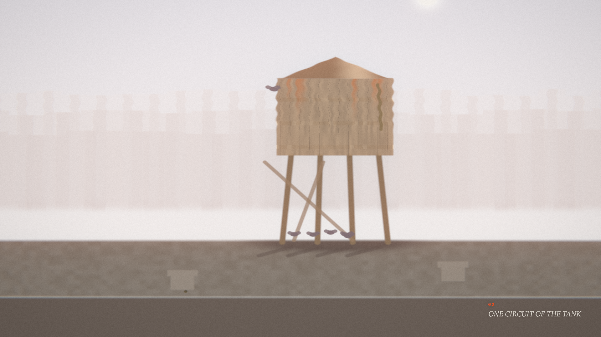
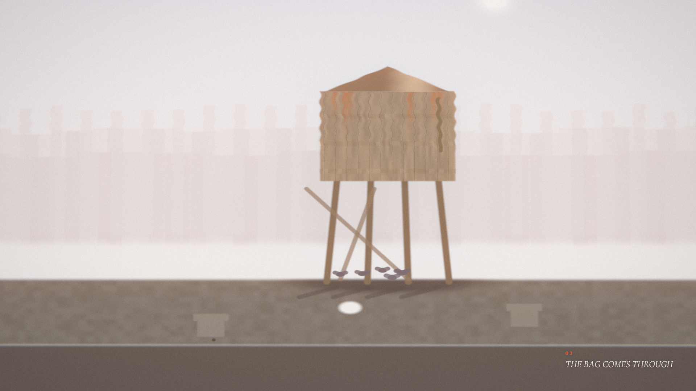
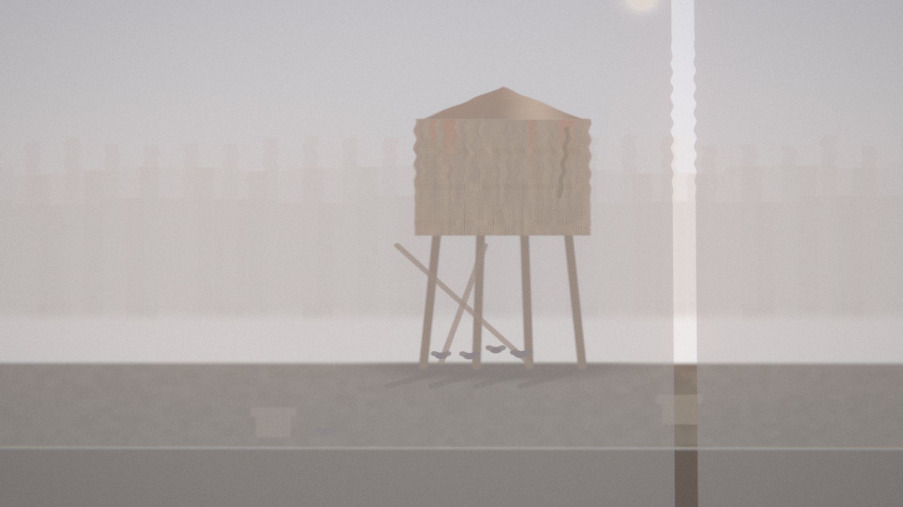

# watertank — storyboard

20 s @ 60 fps, 16:9. Four acts (project.json). Stills below.

## Act 1 — NOON ON THE TAR ROOF (0.0–5.0)
Tank locked mid-frame, pigeons in the shade pool, rope swaying, heat shimmer
over the city layers. t=1.5 establishes the geography.

## Act 2 — ONE CIRCUIT OF THE TANK (5.0–9.5)
Pigeon A lifts off, orbits the tank once, lands back; a sparrow sits the rim;
the tank gives a faint creak. t=7.0 catches the orbit high-side.

## Act 3 — THE BAG COMES THROUGH (9.5–14.0)
The bag tumbles past the stilts, pigeon B crosses to the parapet, the
helicopter speck enters the sky band. t=11.5 is mid-tumble.

## Act 4 — ROOFTOP SETTLE (14.0–20.0)
Pigeon B shuffles along the parapet, the wasp keeps its circuit, shimmer and
sun hold. t=17.5 is the settle.

