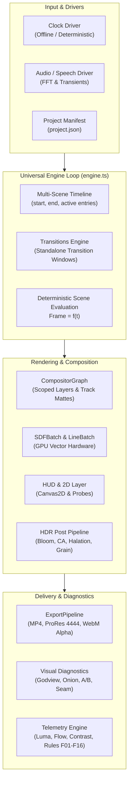

# f(x) Studio: Universal Procedural Motion Engine Architecture

**Platform Version**: v0.5.0  
**License**: PolyForm Small Business License 1.0.0 ([`LICENSE.md`](../../LICENSE.MD))  
**Core Codebase**: [`app/src/engine/`](../../app/src/engine/)  

---

## 1. Executive Summary

**f(x) Studio** is a high-performance procedural animation and rendering engine engineered specifically for autonomous AI coding agents and technical motion designers. Designed as an all-in-one generative motion graphics studio, it provides a unified, decoupled foundation for:

* **Commercial Product Teasers & 3D Hardware Reveals**: Exploded engineering assemblies, precision turntable sweeps, lighting passes, and CAD callouts.
* **UI/UX Interaction Showcases**: Fluid sheet transitions, micro-interactions, modal physics, spatial desktop operating systems, and isometric application flows.
* **Brand Identity & Title Sequences**: Precision vector logo resolves, broadcast bumpers, cinematic titles, and kinetic monograms.
* **Data Visualization & Technical Infographics**: Real-time HUD telemetry, radar grids, network topology charts, and mathematical manifolds.
* **Voiceover Explainers & Kinetic Typography**: Speech-synchronized kinetic type, editorial print in motion, Hershey single-stroke plotter typography, and subtitles.
* **Audiovisual & Music Video Art**: Sound-reactive procedural worlds, beat-synced camera choreography, physics-driven particle vortexes, and spatial scene-to-scene transitions.



---

## 2. Core Architectural Invariants

The engine maintains six non-negotiable invariants. Violating any invariant breaks sub-frame motion blur, causes GPU state corruption, or introduces non-deterministic frame output.

### 2.1 Closed-Form Temporal Determinism: $\text{Frame} = f(t)$

Every visual attribute—camera position, particle coordinates, physical spring displacements, and layout pins—is computed as a pure, stateless mathematical function of timeline time $t$:

$$\text{Frame} = f(t)$$

* **Zero Simulation History**: The engine never relies on frame-by-frame Euler integration state accumulators (`pos += vel * dt`).
* **Seek & Rewind Invariance**: Any timestamp can be evaluated forward, backward, or at random intervals with bit-identical precision.
* **Sub-Frame Adaptive Motion Blur (1 to 324 spp)**: During export, the engine averages up to 324 sub-frames per shutter window ($t \pm \frac{\text{shutter}}{2 \cdot \text{fps}}$). Because evaluation is purely closed-form, sub-sampling never causes simulation divergence, particle jitter, or spring phase drift.

### 2.2 WebGL State Cache Restoration Invariant

Three.js internally caches WebGL state flags (blend equations, depth buffers, active textures, VAO bindings). Custom raw shader passes, fullscreen quads ([`FSPass`](../../app/src/engine/gl.ts)), and instanced batch renderers ([`SDFBatch`](../../app/src/engine/sdf.ts), [`LineBatch`](../../app/src/engine/lines.ts), [`AnalyticalParticles`](../../app/src/engine/particles.ts)) must not leak WebGL state.

> [!IMPORTANT]
> Any direct WebGL rendering pass or custom batch flush must strictly invoke:
> ```typescript
> renderer.resetState();
> ```
> Failure to call `resetState()` does not crash the active pass—it silently corrupts the *subsequent* scene's depth test, blending, or texture unit bindings.

### 2.3 HalfFloat HDR Linear Render Target Ownership

The main rendering pipeline executes on HalfFloat linear-HDR color buffers ([`engine/gl.ts`](../../app/src/engine/gl.ts)):
* Render targets are recycled across scenes and across multi-sampling sub-frames.
* When a scene's `render(f, out)` method is invoked, it **must fully overwrite or clear** the target:
  ```typescript
  renderer.setRenderTarget(out);
  renderer.clear(); // Mandatory before drawing if background is transparent or partial
  ```
* Target allocation is performed via `makeRT(w, h)` in logical units (which automatically scales by `SCALE`). Hardware resolution at `scale: 2` is $3840 \times 2160$ (true 4K).

### 2.4 PCIe Bandwidth Saturation Elimination

Under 324-spp sub-frame supersampling at 4K resolution, streaming vertex data across the PCIe bus produces severe frame rate degradation. The engine enforces:
1. **Static GPU Buffers for Particles**: [`AnalyticalParticles`](../../app/src/engine/particles.ts) allocates fixed attribute buffers (`THREE.StaticDrawUsage`) once during `init()`. Emitter coordinates are evaluated on the GPU or via closed-form parallel math, eliminating per-subframe buffer re-uploads.
2. **GPU Signed Distance Fields**: 2D cards, rounded rectangles, progress rings, and reticles are evaluated on the GPU via [`SDFBatch`](../../app/src/engine/sdf.ts) rather than drawing to CPU-side Canvas2D surfaces and uploading textures each frame.

### 2.5 Strict Font Loading Gate

To eliminate Flash-Of-Unstyled-Text (FOUT) and zero-width typography bounds (which trigger false layout clipping and text collision flags in CI), the engine lifecycle strictly awaits the browser font subsystem:

```typescript
await document.fonts.ready;
```

This gate runs before evaluating Frame 0 in both interactive preview and headless export modes.

### 2.6 Dual-Mode Coordinate System & Logical Pixel Space

All internal engine dimensions operate in logical layout coordinates:
* **Canonical Layout Bounds**: $W = 1920$, $H = 1080$ logical units, regardless of display scale factor or export DPI.
* **Canvas2D & HUD Overlays**: Backing pixels scale automatically via `Layer2D(W, H, scale)`. Text sizes, padding, and layout anchors remain resolution-independent.
* **3D Viewport Bridges**: [`ViewportSpace`](../../app/src/engine/viewport.ts) provides bi-directional transformation between 3D world space coordinates $(X_w, Y_w, Z_w)$ and 2D normalized device coordinates (NDC) / logical canvas pixels.

---

## 3. Engine Lifecycle & Execution Stages

When evaluating time $t$, `Engine.render(t)` progresses through discrete pipeline stages:

```
┌─────────────────────────────────────────────────────────────────────────────┐
│ 1. Time Synchronization & Driver Dispatch (ClockDriver / AudioDriver)       │
├─────────────────────────────────────────────────────────────────────────────┤
│ 2. Timeline Active Window Resolution (project.json -> TimelineEntry[])      │
├─────────────────────────────────────────────────────────────────────────────┤
│ 3. Transition Window Check (resolveTransitionAt -> standalone transition)   │
│    ├─ If active: Render Scene A, Render Scene B, Composite via Transition  │
│    └─ If single: Render Active Scene (Scene.render)                         │
├─────────────────────────────────────────────────────────────────────────────┤
│ 4. Scoped Compositor Graph Evaluation (Track Mattes & Layer Blending)       │
├─────────────────────────────────────────────────────────────────────────────┤
│ 5. 2D Typography & HUD Overlay Pass (Layer2D -> Canvas Probes Intercept)   │
├─────────────────────────────────────────────────────────────────────────────┤
│ 6. HDR Post-Processing Pipeline (Bloom, Halation, CA, Grain, Vignette)      │
├─────────────────────────────────────────────────────────────────────────────┤
│ 7. Telemetry & Diagnostics Probe Emission (window.__motion telemetry)      │
└─────────────────────────────────────────────────────────────────────────────┘
```

---

## 4. Multi-Project Directory Structure

The engine codebase is organized cleanly to separate the core engine library, diagnostic tools, and user projects:

```
Agentic motion design toolset/
├── app/
│   ├── src/
│   │   ├── engine/             # Core Universal Engine Modules (12 modules)
│   │   ├── scenes/             # Project Registry & Scene Definitions
│   │   │   ├── active.json     # Active project pointer
│   │   │   ├── <project_dir>/  # Modular project directories (e.g. brand_campaign, product_reveal)
│   │   │   │   ├── project.json# Scene entries, timeline offsets & transitions
│   │   │   │   └── *.ts        # Declarative DSL or raw Scene modules
│   │   │   └── ...
│   │   ├── transitions/        # 16 Standalone Transition Modules
│   │   └── main.ts             # Browser entrypoint & runtime UI
│   └── scripts/
│       ├── render.ts           # Master offline headless renderer
│       ├── motion/             # Telemetry pixel metrics & text analyzer
│       └── visual/             # 4 Operational visual diagnostic instruments
├── docs/                       # Categorized Documentation Hub
├── out/                        # Rendered video & diagnostic image artifacts
└── calibration/                # Empirical benchmark reference distributions
```
