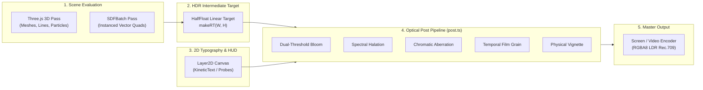

# WebGL Compositor & Post-Processing Pipeline

**Platform Version**: v0.7.0  
**Source Files**: [`app/src/engine/gl.ts`](../../app/src/engine/gl.ts), [`app/src/engine/post.ts`](../../app/src/engine/post.ts), [`app/src/engine/graph.ts`](../../app/src/engine/graph.ts)  

---

## 1. Overview

The rendering architecture of **f(x) Studio** operates on an uncompressed HalfFloat ($16$-bit floating-point) linear-HDR color pipeline. By decoupling 3D WebGL scene rendering, 2D vector typography overlays, and optical post-processing passes into separate compositor stages, the engine delivers cinematic image fidelity while maintaining exact deterministic reproducibility.



---

## 2. Render Target Management & Memory Invariants ([`gl.ts`](../../app/src/engine/gl.ts))

All offscreen render targets are created via the engine's `makeRT()` helper, which automatically coordinates resolution scaling:

```typescript
export function makeRT(w = W, h = H, opts?: Partial<THREE.RenderTargetOptions>): THREE.WebGLRenderTarget {
  return new THREE.WebGLRenderTarget(w * SCALE, h * SCALE, {
    type: THREE.HalfFloatType,
    format: THREE.RGBAFormat,
    minFilter: THREE.LinearFilter,
    magFilter: THREE.LinearFilter,
    depthBuffer: opts?.depthBuffer ?? true,
    stencilBuffer: false,
    ...opts,
  });
}
```

### Critical Target Invariants
1. **Target Dimensions vs. Logical Coordinates**:
   - `W` and `H` are always canonical logical units ($1920 \times 1080$).
   - Physical pixel dimensions on the GPU are $(W \cdot \text{SCALE}, H \cdot \text{SCALE})$.
   - At `--scale 2` (true 4K UHD), `out.width = 3840`, `out.height = 2160`.
2. **Buffer Recycling**:
   - The master engine recycles intermediate render targets across scenes (`mixRT`, `transRTs`, and `transScratch`).
   - Every scene **must overwrite or clear** its assigned render target on entry:
     ```typescript
     renderer.setRenderTarget(out);
     renderer.clear(true, true, true);
     ```
3. **Texture Upload Optimization (`clearRT`)**:
   - Fast GPU-side clearing without CPU memory reallocation.

---

## 3. Fullscreen Quad Passes (`FSPass`)

Fullscreen quad shaders are executed through `FSPass`, which encapsulates a single orthographic camera, unit plane geometry, and custom fragment shader:

```typescript
export class FSPass {
  constructor(fragmentShader: string, uniforms?: Record<string, THREE.IUniform>);
  render(renderer: THREE.WebGLRenderer, target: THREE.WebGLRenderTarget | null, clear = true): void;
}
```

### WebGL State Cache Restoration
When authoring custom raw shader passes or using `FSPass`, developers must preserve Three.js internal render state:

```typescript
// Custom Pass Execution
fsPass.render(renderer, targetRT);

// Mandatory state restoration
renderer.resetState();
```

---

## 4. 2D Layer Plumbing: `Layer2D`

`Layer2D` provides an offscreen HTML5 2D canvas backing for typography, vector HUD elements, and telemetry probe interception:

```typescript
export class Layer2D {
  canvas: HTMLCanvasElement;
  ctx: CanvasRenderingContext2D;
  texture: THREE.CanvasTexture;

  constructor(public w = W, public h = H, scale = SCALE);
  clear(): void;
  upload(): void; // Marks texture.needsUpdate = true
}
```

* **HiDPI Scaling**: The canvas backing resolution is multiplied by `scale` to guarantee crisp text rendering at 4K.
* **Canvas2D Context**: Authors draw using logical $1920 \times 1080$ coordinates; the context transform handles scale internally.

---

## 5. Optical Post-Processing Pipeline ([`post.ts`](../../app/src/engine/post.ts))

The engine implements an alpha-preserving, optical HDR post-processing stack. Each scene can emit custom `PostOverrides` dynamically per frame:

```typescript
export interface PostOverrides {
  exposure?: number;       // Exposure multiplier (default 1.0)
  bloom?: number;          // Bloom intensity (0.0 to 1.5)
  bloomThreshold?: number; // Luminance cutoff threshold (default 0.75)
  ca?: number;             // Chromatic aberration spread in px (default 1.0)
  halation?: number;       // Red-orange edge bleeding intensity (default 0.2)
  vignette?: number;       // Darkening towards frame periphery (default 0.3)
  grain?: number;          // Per-pixel high-frequency film grain (default 0.03)
  flash?: number;          // Additive whiteout impact flash (0.0 to 1.0)
  shake?: [number, number];// Screen-space camera impulse shake [pxX, pxY]
}
```

### Post-Processing Stages

1. **Exposure & White Balance**:
   - Applies linear exposure scaling in HDR color space.
2. **Dual-Threshold Optical Bloom**:
   - High-luminance isolation with soft knee falloff:
     $$\text{bright}(C) = \max\left(0, \frac{L(C) - \text{threshold}}{1.0 - \text{threshold}}\right) \cdot C$$
   - 9-tap separable Gaussian blur downsampled across intermediate mip-targets.
3. **Spectral Halation**:
   - Emulates analog film halation by diffusing saturated warm wavelengths (red-orange flare) around high-contrast edges without washing out black levels.
4. **Radial Chromatic Aberration**:
   - Wavelength dispersion offsetting the red, green, and blue color channels radially from the optical center:
     $$r_{\text{offset}} = \text{ca} \cdot \left(\frac{r}{r_{\text{max}}}\right)^2$$
5. **Physical Vignette**:
   - Cosine-fourth falloff modeling real optical lens barrel vignetting:
     $$V(r) = 1.0 - \text{vignette} \cdot \left(\frac{r}{r_{\text{max}}}\right)^2$$
6. **Temporal Film Grain**:
   - High-frequency monochromatic noise generated procedurally via a high-speed hash function, avoiding static repetition.
7. **Additive Impact Flash & Trauma Shake**:
   - Screen-space sub-pixel displacement impulses applied dynamically during collision impacts or beat drops.
