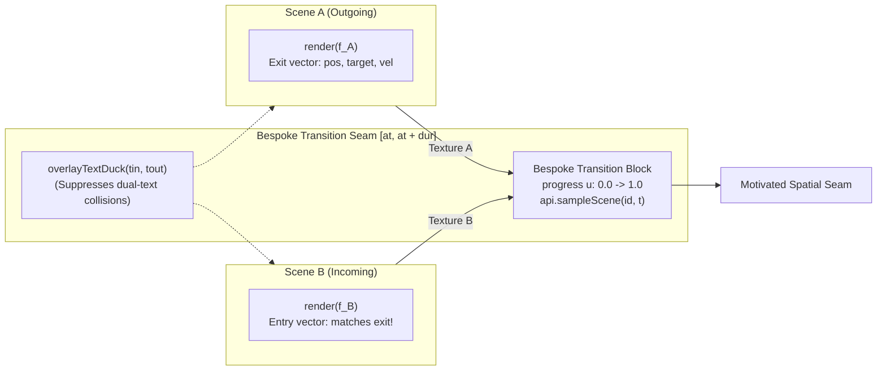

# Bespoke Transitions Engine & Spatial Continuity Architecture

**Platform Version**: v0.5.0  
**Implementation Files**: [`app/src/engine/transition.ts`](../../app/src/engine/transition.ts), [`app/src/engine/projects.ts`](../../app/src/engine/projects.ts), [`app/src/transitions/`](../../app/src/transitions/)  

---

## 1. Core Philosophy: Bespoke & Motivated Transitions

In standard video editors and basic template tools, transitions are treated as a static library of canned stock wipes (cross-fades, sliding blinds, circle wipes) slapped between unrelated clips. In premium motion graphics, canned transitions feel cheap, disconnected, and unmotivated.

**f(x) Studio is designed around bespoke, motivated transitions created in concert with the scenes themselves.**

A transition is an architectural bridge between two distinct visual worlds. Rather than generic pixel mixing, the engine enables:
- **Carrier Match-Cuts**: A focal subject, geometric shape, or typographic token in Scene A carries over and morphs directly into a corresponding element in Scene B (e.g. a bank vault combination dial morphing into a 1930s speedometer gauge).
- **Kinetic Vector Continuity**: Camera velocity, focal vectors, and momentum carry through the cut without freezing or hitching (e.g. accelerating into a crash-zoom through a window).
- **Physical & Material Seams**: Spatial breaches motivated by the narrative (e.g. shattering gauge glass, tearing paper, or deconstructing 3D point clouds).



---

## 2. The Three Transition Paradigms in the Engine

The engine supports three distinct approaches to handling scene boundaries:

```
┌─────────────────────────────────────────────────────────────────────────────┐
│                       THE THREE TRANSITION PARADIGMS                        │
├─────────────────────────────────────────────────────────────────────────────┤
│                                                                             │
│   PARADIGM 1: BESPOKE STANDALONE TRANSITION BLOCKS (Primary Pattern)        │
│   • Subclasses `Transition` in `app/src/transitions/`.                      │
│   • Owns the boundary externally so scene code stays pure and decoupled.    │
│   • Receives Texture A, Texture B, progress u, and `api.sampleScene()`.     │
│   • Perfect for match-cuts, camera crash morphs, and shader deconstructions.│
│                                                                             │
│   PARADIGM 2: SCENE-INTERNAL SPATIAL HANDOFFS (`handlesTransition = true`)  │
│   • The incoming scene directly consumes `f.under` inside its 3D world.     │
│   • Renders the previous scene onto a 3D surface (doorway, window, mirror). │
│   • The camera physically breaches the threshold into the new world.        │
│                                                                             │
│   PARADIGM 3: GENERIC UTILITY TRANSITIONS (Fallback / Editorial)            │
│   • Simple utility transitions (`dissolve`, `push`, `warp`, `shutter`).     │
│   • Used when a clean, unmotivated optical cut or cross-fade is sufficient. │
│                                                                             │
└─────────────────────────────────────────────────────────────────────────────┘
```

---

## 3. How the Transition Engine Works Internally

### 3.1 The Standalone `Transition` Contract
A standalone transition implements the `Transition` interface (`app/src/engine/transition.ts`):

```typescript
export interface TransitionAPI {
  /** 0..1 normalized progress across the transition window */
  u: number;
  /** Entry IDs on either side of the seam */
  from: string;
  to: string;
  /**
   * Re-render a participant scene at ANY time t into an engine-managed
   * scratch target and return its texture. Enables true 3D object-level
   * choreography rather than static 2D texture blending!
   */
  sampleScene(id: string, t: number): THREE.Texture;
}

export interface Transition {
  render(
    f: Frame,
    out: THREE.WebGLRenderTarget,
    a: THREE.Texture,
    b: THREE.Texture,
    api: TransitionAPI,
  ): PostOverrides | void;
}
```

### 3.2 The Power of `sampleScene(id, t)`
In basic fragment shaders, you can only blend the pre-rendered frames $A(t)$ and $B(t)$.

In **f(x) Studio**, `api.sampleScene(id, t)` allows the transition to re-evaluate participant scenes at arbitrary off-path timestamps. For example:
- **Speed Ramping**: You can evaluate Scene A at $2\times$ or $4\times$ speed during the last $0.25\,\text{s}$ to create a high-speed motion-blur whip into Scene B.
- **Freeze & Shatter**: You can freeze Scene A at $t = t_{\text{cut}}$, project that texture onto physical 3D Voronoi shards, and explode them toward the lens while Scene B continues playing underneath.

### 3.3 Transition Window Geometry (`project.json`)
Transitions are declared in the project manifest:

```json
{
  "id": "t-speedo-shatter",
  "transition": "mirror_shatter",
  "from": "act2_speedometer",
  "to": "act3_cash_breach",
  "at": 33.55,
  "dur": 0.50
}
```

- **Window Span**: Starts at $\text{at} - \frac{\text{dur}}{2}$ (or $\text{at}$ depending on alignment) and spans $\text{dur}$ seconds.
- **Normalized Progress $u(t)$**:
  $$u(t) = \text{clamp}\left(\frac{t - \text{start}}{\text{dur}}, 0, 1\right)$$
  - At start: $u = 0.0$ (100% Scene A).
  - At mid-point: $u = 0.5$ (Exact transition center).
  - At end: $u = 1.0$ (100% Scene B).

### 3.4 The Stateless Participant Invariant
> [!CRITICAL]
> Standalone transitions evaluate both participating scenes simultaneously across the window and may call `sampleScene` at non-linear times. Both scenes **must be stateless** ($\text{Frame} = f(t)$). Evaluating a stateful scene with mutable Euler accumulators inside a transition corrupts its simulation history and throws an engine exception.

---

## 4. The Broadcast Text Ducking Contract (`overlayTextDuck`)

A common flaw in multi-scene motion design is **dual-legibility collision**: during a transition window, outgoing typography from Scene A overlaps incoming typography from Scene B, creating an unreadable visual mess that triggers Rule `F04` (`text_collision`).

f(x) Studio enforces a broadcast-standard anti-collision ducking curve:

$$\text{duck}(t_{\text{in}}, t_{\text{out}}) = \min\left(1, \max\left(0, (1 - \text{smoothstep}(0, 0.35, t_{\text{out}})) \cdot \text{smoothstep}(0.55, 1, t_{\text{in}})\right)\right)$$

```
OVERLAY TEXT DUCK PROGRESSION
1.0 ──────┐                                       ┌─────── 1.0 (Incoming Text)
          │                                       │
          │ (Outgoing Text)                       │
0.0       └───────────┬───────────────────────────┴─────── 0.0
          0%         35%                         55%      100%
```

- **Outgoing Text**: Driven to $0\%$ opacity by $35\%$ of the exit overlap window ($t_{\text{out}} = 0.35$).
- **Incoming Text**: Kept at $0\%$ opacity until $55\%$ of the entrance overlap window ($t_{\text{in}} = 0.55$).
- **Result**: Outgoing and incoming text are **never legible at the same instant**, eliminating seam text mush by mathematical construction.

In declarative DSL scenes (`defineScene`), `ctx.overlayDuck` is pre-calculated and automatically multiplied into `renderText` and `card`. If you draw Canvas2D text manually, apply the duck factor:
```typescript
const duck = overlayTextDuck(f.tin, f.tout);
ctx.globalAlpha *= duck;
```

---

## 5. How to Author a Bespoke Transition (Step-by-Step)

When designing a transition between two scenes, follow this directorial workflow:

### Step 1: Establish the Spatial Contract ($T_n$)
Align the exit camera vector of Scene A with the entry camera vector of Scene B:
- $\mathbf{p}_{\text{exit}} \approx \mathbf{p}_{\text{entry}}$
- $\mathbf{v}_{\text{exit}} \approx \mathbf{v}_{\text{entry}}$ (velocity direction and magnitude match)
- $\text{FOV}_{\text{exit}} = \text{FOV}_{\text{entry}}$

### Step 2: Implement the Transition Class
Create a new file in `app/src/transitions/<your_transition>.ts`:

```typescript
import * as THREE from 'three';
import type { Transition, TransitionCtx, TransitionAPI } from '../engine/transition';
import type { Frame, PostOverrides } from '../engine/scene';
import { FSPass } from '../engine/gl';

// FSPass automatically injects WebGL2 / GLSL 3.0 declarations:
// 'in vec2 vUv;' and 'out vec4 fragColor;' plus GLSL_COMMON helpers.
const FRAG_SHADER = /* glsl */ `
uniform sampler2D tA;
uniform sampler2D tB;
uniform float uProgress;
uniform vec2 uResolution;

void main() {
  vec2 uv = vUv;
  
  // Custom bespoke optics: Radial aperture collapse
  vec2 center = vec2(0.5, 0.5);
  float dist = distance(uv, center);
  float radius = (1.0 - uProgress) * 0.75;
  
  vec4 colA = texture(tA, uv);
  vec4 colB = texture(tB, uv);
  
  // Clean circular mask with soft edge
  float mask = smoothstep(radius - 0.05, radius + 0.05, dist);
  fragColor = mix(colA, colB, mask);
}
`;

export default class BespokeApertureTransition implements Transition {
  private pass: FSPass;

  constructor(private ctx: TransitionCtx) {
    this.pass = new FSPass(FRAG_SHADER, {
      tA: { value: null },
      tB: { value: null },
      uProgress: { value: 0 },
      uResolution: { value: new THREE.Vector2(ctx.W, ctx.H) },
    });
  }

  render(
    f: Frame,
    out: THREE.WebGLRenderTarget,
    a: THREE.Texture,
    b: THREE.Texture,
    api: TransitionAPI,
  ): PostOverrides | void {
    // 1. Update shader uniforms via this.pass.u
    this.pass.u.tA!.value = a;
    this.pass.u.tB!.value = b;
    this.pass.u.uProgress!.value = api.u;

    // 2. Render full-screen pass to output target
    this.pass.render(this.ctx.renderer, out, true);

    // 3. WebGL State Preservation Invariant
    this.ctx.renderer.resetState();

    // 4. Return dynamic post overrides (e.g. lens flash at mid-seam)
    const flash = Math.sin(api.u * Math.PI) * 0.15;
    return {
      bloom: 0.20 + flash,
    };
  }

  dispose(): void {
    this.pass.dispose();
  }
}
```

### Step 3: Wire into `project.json`
```json
{
  "id": "t-bespoke-01",
  "transition": "bespoke_aperture",
  "from": "hero_chassis",
  "to": "engine_dyno",
  "at": 18.81,
  "dur": 0.50
}
```

### Step 4: Audit with the Seam Stitch Inspector
Run the stitch diagnostic tool to inspect the seam:
```bash
bun scripts/stitch.ts --from-scene hero_chassis --to-scene engine_dyno --t 18.81
```
Inspect `onion_seam.png` (green/magenta false color) and `strip_seam.png` (10-frame filmstrip) to confirm that:
- The carrier geometry aligns without sudden coordinate jumps.
- Horizon tilt is stable.
- There are no 1-frame blackout drops.

---

## 6. Archetypal Transition Techniques & Mathematical Patterns

When authoring a bespoke transition between two scenes, you can draw from several proven architectural and mathematical patterns:

| Transition Technique | Core Mathematical / Optical Pattern | Recommended Motion Application |
| :--- | :--- | :--- |
| **Concentric Aperture Match-Cut** | Concentric radial zoom: $r(u) = (1 - u)^3 \cdot r_0 + u^3 \cdot r_1$. Scales a circular carrier token in Scene A until it aligns with an outer circular bezel in Scene B. | Carrier shape morphs, lens dives, portal apertures. |
| **Physical Voronoi Shatter** | Voronoi cell decomposition with closed-form ballistic displacement: $\mathbf{p}_i(u) = \mathbf{p}_{i,0} + \mathbf{v}_i \cdot u + \frac{1}{2}\mathbf{g} u^2$. Evaluates Scene A as frozen texture via `sampleScene`. | High-impact musical beat drops, glass breaches, explosive cutoffs. |
| **Luminance Threshold Blast** | Exponential luminance threshold curve coupled with optical bloom override: $\text{flash} = \exp(-\lambda u) \cdot \text{step}(Y, Y_{\text{thresh}})$. | Percussive snare strikes, laser pulses, electrical discharges. |
| **Topological Manifold Tear** | Fragment-shader UV coordinate displacement splitting the plane along an analytical noise curve: $\text{uv}' = \text{uv} + \text{sign}(\text{uv}.x - \text{split}) \cdot \text{offset}(u)$. | Higher-dimensional reveals, paper tears, dimensional transitions. |
| **Anamorphic Lens Streak** | Horizontal anamorphic flare wipe: 1D Gaussian kernel stretched along the X-axis with chromatic dispersion ($\text{offset}_R \ne \text{offset}_B$). | Cinematic horizontal wipes, lighting flare cuts. |
| **Spring-Damped Spatial Punch** | Second-order under-damped harmonic oscillator ($m\ddot{x} + c\dot{x} + kx = 0$) driving scale overshoot and settle. | UI modal expansions, logo reveals, badge state changes. |
| **Optical Baseline Utilities** | Directional spatial translation ($x' = x \pm u$), radial barrel warp, or smoothstep luma crossfade. | Subtle pace adjustments, chapter headers, minimal documentary cuts. |
