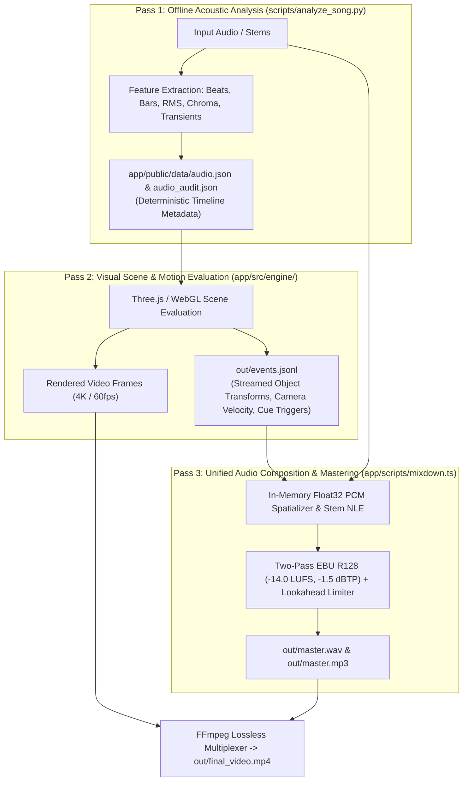
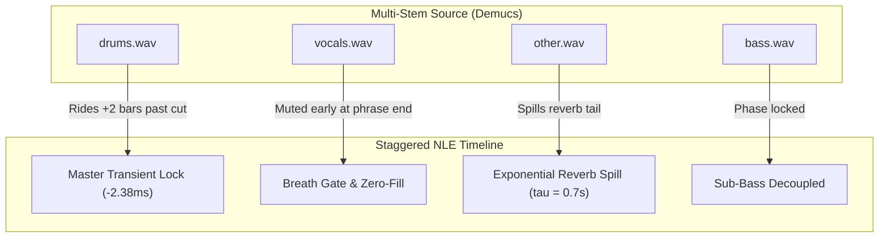
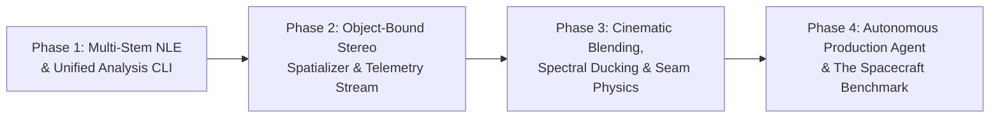

# f(x) Studio v0.8.0 Master Architecture Specification: Unified Audiovisual Production & Scene-Bound Audio System

**Status:** Approved Master Architecture Blueprint  
**Authors:** Viopls & Antigravity (f(x) Studio Core Architecture)  
**Target Engine Version:** f(x) Studio v0.8.0+  
**Scope:** Scene-Bound 3D Audio, Multi-Stem NLE, Acoustic Telemetry, Cinematic DSP, Modular Engine Subsystems, and Autonomous Agent Production  

---

## 1. Executive Summary & Core Philosophy

**The Vision:** Expand f(x) Studio from a procedural motion-design engine with downstream audio assembly into the world’s first **Unified Audiovisual Production Engine**, where an autonomous AI agent directs visual geometry, 3D camera choreography, music composition, and tactile sound design as a single, coordinated production.

```
       Visual Scene Graph & CameraRig          Soundtrack Stems & Procedural Audio
                     │                                         │
                     └───► [ Unified Production Model ] ◄──────┘
                                         │
                    ┌────────────────────┼────────────────────┐
                    ▼                    ▼                    ▼
             3D Object Transforms   Shared Event Bus    Acoustic Telemetry
             (pos, vel, depth)      (cues, cuts, hits)  (bars, chroma, RMS)
```

### The 99.9% Reliability Filter (Stripping the Bloat)
A production engine must be predictable, headless-safe, and rock-solid. To prevent performance degradation and acoustic bugs, we strictly eliminate over-engineered features that fail in headless or automated environments:
1. **NO Mesh Raycasting for Acoustics:** We do not compute 3D mesh polygon intersections to simulate sound occlusion or early reflections. Instead, we use **declarative acoustic tags and zones** (`zone: "tunnel"`, `occluded: true`).
2. **NO Real-Time Phase-Vocoder Doppler on Music Stems:** We do not pitch-shift complex pre-recorded polyphonic music files in real time (which creates metallic smearing and phase dropouts). Full Doppler pitch modulation is restricted to **procedural synth oscillators** (`synth.ts`), while recorded stems simulate speed passes via **amplitude ramps, fast stereo vector pans, and dynamic LPF sweeps**.
3. **NO Frame-by-Frame Circular Pipeline Dependencies:** Visuals and audio do not cross-depend on each other within the same render loop. We enforce a strict **linear 3-pass pipeline**.

---

## 2. The Strict 3-Pass Linear Production Pipeline

To guarantee 100% deterministic, zero-jitter rendering, the pipeline executes in three sequential, decoupled passes:



* **Pass 1:** Visuals read pre-computed acoustic features (`audio.json`) for audio-reactivity (bass pulses, beat-driven typography, downbeat transitions).
* **Pass 2:** Visual execution emits a lean, streamed telemetry stream (`events.jsonl`) logging object positions, camera velocity, and scene transitions without loading audio DSP.
* **Pass 3:** The audio engine ingests `events.jsonl`, binds spatial audio to scene objects, sequences multi-stem edits, applies ducking and filtering, and masters the final soundtrack in pure Bun Float32 memory.

---

## 3. Subsystem A: Decoupled Scene-Bound Audio & Stereo-First Spatialization

Audio sources attach directly to elements in the scene graph (objects, lights, particle emitters, cameras). The visual engine writes screen/world coordinates; the audio engine computes spatial DSP offline in Bun/TypeScript memory.

### 1. Scene Graph Binding (`app/src/engine/audio/telemetry.ts`)
In scene code (`app/src/scenes/spacecraft/scene_docking.ts`):
```typescript
this.emitAudioTelemetry("ship_engine", {
  pos: [this.ship.position.x, this.ship.position.y, this.ship.position.z],
  velocity: this.ship.velocity.length(),
  zone: this.inHangar ? "hangar" : "vacuum",
  occluded: this.isBehindBulkhead(this.ship.position),
});
```

### 2. Audio Manifest Binding (`app/src/scenes/spacecraft/audio/mix.ts`)
```typescript
import { defineMix } from "@/engine/audio";

export default defineMix({
  spatialSources: [
    {
      id: "spacecraft_engine_sfx",
      file: "sfx/thruster_rumble.wav",
      bus: "sfx",
      bindTo: "ship_engine",
      spatial: {
        mode: "screen_vector",
        maxPan: 0.65,
        distanceAttenDb: 12.0,
        distanceLpfHz: [16000, 2500],
        occlusionNotchDb: 6.0
      },
      modulation: {
        velocityToGainDb: [0.0, 4.5],
        velocityToPitchCents: [-200, 300]
      }
    }
  ]
});
```

### 3. Layer-by-Layer Spatial Behaviors

| Audio Layer | Spatial Mapping | Acoustic Rules |
| :--- | :--- | :--- |
| **Tactile Micro-Foley** | Screen-Space $X/Y$ Coordinates | Clamped to $\text{Pan} \in [-0.65, +0.65]$. Razor-sharp attack, zero reverb. |
| **Kinetic Whooshes** | Camera Angular Velocity ($d\theta/dt$) | Vector pan sweep ($L40 \to R40$); peak lands on Frame 0 of cut. |
| **Macro Impacts & 808 Sub**| Mono Dead Center ($C$) | Frequencies $< 100\,\text{Hz}$ are phase-locked to center (never panned). |
| **Ambient Bed** | $100\%$ Ultra-Wide Stereo | Continuous room tone / HVAC at $-26\,\text{dB}$ gluing scenes together. |
| **Soundtrack Bed** | Dynamic Stereo Width | $60\text{--}70\%$ during technical narration; blooms to $125\%$ on epic reveals. |

### 4. Acoustic Depth & Air Absorption Physics
* **Distance Attenuation:** Volume decays using a clamped inverse-square law:
  $$\text{Gain}(d) = \text{clamp}\left(\frac{d_{\text{ref}}}{d_{\text{ref}} + d}, 10^{-\text{maxAtten}/20}, 1.0\right)$$
* **Air Absorption (Z-Depth Filter):** High frequencies roll off via a zero-delay Biquad or Cytomic State Variable Filter (`lp` mode, $20\,\text{kHz} \to 3.5\,\text{kHz}$) as $+Z$ distance increases.
* **Declarative Occlusion:** When `occluded: true` is received, applies a $-6\,\text{dB}$ high-shelf cut at $1.2\,\text{kHz}$ without requiring geometric raycasting.

### 5. The k-rate to a-rate Bridge (De-Zippering Smoother)
Pass 2 emits telemetry at $60\,\text{Hz}$ ($16.67\,\text{ms}$ intervals), while Pass 3 audio DSP operates at $48,000\,\text{Hz}$ ($0.0208\,\text{ms}$ sample intervals). To eliminate audible zipper noise and stair-stepping clicks during camera sweeps, all telemetry modulation signals (pan, gain, filter cutoff) pass through a 1-pole parameter smoother:
$$y[n] = (1 - \alpha) \cdot x[n] + \alpha \cdot y[n - 1], \quad \alpha = \exp\left(-\frac{1}{\tau \cdot f_s}\right)$$
Tuned to $\tau \approx 5\text{--}10\,\text{ms}$ for click-free, transient-preserving modulation.

---

## 4. Subsystem B: Stem-Aware Nonlinear Editing & Staggered Transitions

Rather than flattening music into an unchangeable audio block, stems are treated as independent timeline actors governed by a shared musical grid.



### Unified Excision Schema with Staggered Stem Leads/Lags
```typescript
export default defineMix({
  soundtracks: [
    {
      id: "main_theme",
      bus: "music",
      stems: {
        drums: "stems/drums.wav",
        bass: "stems/bass.wav",
        vocals: "stems/vocals.wav",
        other: "stems/other.wav"
      },
      edits: {
        quantize: "bars",
        excise: [
          {
            fromBar: 23,
            toBar: 31,
            masterTransientLock: true, // Snaps ALL stems together to kick pre-attack
            stems: {
              drums: { leadBars: 0, lagBars: 2 },
              vocals: { leadBars: -1, lagBars: 0, breathGate: true },
              other: { tailSpillover: { spillSec: 2.2, tauSec: 0.7 } }
            }
          }
        ]
      }
    }
  ]
});
```

### Surgical Physical Seam Primitives:
1. **Master `transientLock` (Percussion & Bleed Preservation):** Offsets the incoming cut across **all stems simultaneously** to the kick drum's pre-attack zero crossing ($-2.38\,\text{ms}$) with an asymmetric crossfade ($3\,\text{ms}$ out, $0\,\text{ms}$ in). Locking all stems together prevents comb filtering and phase cancellation caused by stem bleed.
2. **`tailSpillover` (Harmonic Stems):** Reads past the cut point into the excised region, applies an analytical decay envelope $\text{Decay}(t) = \exp(-t/\tau)$, and overlays it across the incoming scene for $1.5\text{--}2.5\,\text{s}$.
3. **`breathGate` (Vocals):** Snaps to phrase silences ($\ge 120\,\text{ms}$), mutes orphan breath gasps, and zero-fills the seam gap.
4. **Sub-Bass Decoupling:** Replaces complex FFT phase alignment with architectural collision prevention: visual SFX sub-drops and musical 808 kicks are never scheduled on the same downbeat frame.

---

## 5. Subsystem C: Cinematic Staging & Anti-Mud Blending

Tools that prevent sound effects, voiceover, and music from fighting for frequency space:

```
[FREQUENCY POCKET ALLOCATION]
  20 Hz       100 Hz            300 Hz               1 kHz             4 kHz        8 kHz      20 kHz
  ┌─────────────┬──────────────────┬───────────────────┬─────────────────┬────────────┬──────────┐
  │  SUB-BASS   │    BASS PUNCH    │   WARMTH / MUD    │  VOCAL CLARITY  │ TACTILE    │ AIR /    │
  │ (30-80 Hz)  │   (80-250 Hz)    │   (250-800 Hz)    │   (1.0-3.5 kHz) │ PRESENCE   │ GLINTS   │
  ├─────────────┼──────────────────┼───────────────────┼─────────────────┼────────────┼──────────┤
  │ Structural  │ Musical Kick /   │ Music Chords /    │ Narration &     │ Foley      │ Air Hiss │
  │ Sub-Drops   │ Basslines        │ Ambience Bed      │ Spoken Voice    │ Clicks     │ Cymbals  │
  └─────────────┴──────────────────┴───────────────────┴─────────────────┴────────────┴──────────┘
```

1. **The Vocal Sanctuary (Dynamic Spectral Notch):**
   * Human speech clarity lives in $1.0\,\text{kHz} \dots 3.5\,\text{kHz}$.
   * The engine applies a dynamic $-3.5\,\text{dB}$ bell notch at $2.2\,\text{kHz}$ ($Q = 1.2$) on the music bus triggered by narration presence ($\text{threshold} = -42\,\text{dBFS}$, $\text{attack} = 15\,\text{ms}$, $\text{hold} = 80\,\text{ms}$, $\text{release} = 250\,\text{ms}$).
2. **Split-Band Ducking:**
   * Attenuates mid/high frequencies above $250\,\text{Hz}$ while leaving the low band ($< 250\,\text{Hz}$) at $0\,\text{dB}$ so the track's physical weight never collapses.
3. **Sub-Bass Decoupling:**
   * Prevents visual SFX sub-drops and musical 808 kicks from stacking on the same downbeat, protecting dynamic headroom.
4. **Low-Pass Filter Focus Dives:**
   * Sweeps music cutoff ($20\,\text{kHz} \to 350\,\text{Hz}$) over 1–2 bars during diagrammatic explanations or zooms, snapping back to full fidelity on the drop.
5. **The Pre-Drop Silence Vacuum:**
   * 1–2 video frames ($16\text{--}33\,\text{ms}$) of absolute digital silence before massive visual impacts, amplifying perceived acoustic hit strength.
6. **Anti-Machine-Gun Pitch Jitter (Atonal Foley Only):**
   * Procedural foley applies deterministic pseudorandom pitch jitter ($\pm 2.5\%$) via `mulberry32` strictly for mechanical UI clicks and typewriter hits. Tonal elements default to `jitter: false` to prevent sour musical tuning clashes.
7. **Lookahead True Peak Limiter:**
   * Pure in-memory $1\text{--}2\,\text{ms}$ lookahead peak limiter applied prior to loudnorm to catch inter-sample peaks, guaranteeing clean dynamics without clipping distortion.

---

## 6. Subsystem D: Unified Acoustic Telemetry Engine (`analyze_song.py`)

A single, deterministic analysis CLI that computes objective ground truth without black-box AI heuristics:

```bash
python scripts/analyze_song.py --audio song/track.mp3 --stems stems/htdemucs/ --audit --out data/audio_audit.json
```

### Telemetry Output (`data/audio_audit.json`):
```json
{
  "tempo": { "bpm": 95.34, "meter": "4/4", "totalBars": 56 },
  "candidateCuts": [
    {
      "fromBar": 23,
      "toBar": 31,
      "fromSec": 56.028,
      "toSec": 76.146,
      "metrics": {
        "chromaCosineSimilarity": 0.982,
        "bassRootMatch": "F# -> F#",
        "vocalSilenceGapSec": 1.24,
        "kickPreAttackOffsetMs": -2.38,
        "reliabilityScore": 0.998
      }
    }
  ]
}
```

---

## 7. Subsystem E: Broadcast Mastering & Delivery Pipeline

Master output is rendered directly in memory via Bun and FFmpeg:
* **Loudness Compliance:** Two-pass EBU R128 ($-14.0 \pm 0.5\,\text{LUFS}$, True Peak $\le -1.5\,\text{dBTP}$).
* **Void Gate:** Hard digital silence gating across visual blackout frames.
* **Master Outputs:** 48kHz / 24-bit stereo WAV and 320kbps MP3 verified automatically via `verify_audio.py`.

---

## 8. Subsystem F: Project Encapsulation, Scoped Assets & Multi-Track Architecture

All project assets, audio stems, custom transitions, and analysis data are strictly encapsulated within the project directory (`app/src/scenes/<project_name>/`).

```
app/src/scenes/<project_name>/
├── project.json                    # Project manifest, scene sequence & timeline
├── scene_act1.ts                   # Scene visual code
├── scene_act2.ts                   # Scene visual code
│
├── transitions/                    # Project-Specific Bespoke Transitions
│   ├── asteroid_shatter.ts         # Custom transition unique to this project
│   └── warp_seam.ts                # (Falls back to app/src/transitions/ if not found here)
│
├── audio/                          # Project Audio Assets & Mix Configuration
│   ├── mix.ts                      # Type-safe defineMix({ ... }) manifest
│   ├── narration.wav               # Voiceover dialogue track
│   ├── sfx/                        # Project-specific foley / impacts
│   └── out/                        # Rendered master (mix.wav, master.mp3)
│
└── analysis/                       # Multi-Track Audio Analysis Directory
    ├── track_01_intro/             # Isolated analysis for Song 1 (Intro theme)
    │   ├── audio.json              # 100Hz features & 60Hz display envelopes
    │   ├── audio_audit.json        # Downbeat grid, bar map & candidate cut matrix
    │   └── stems/                  # Separated Demucs stems (drums, bass, vocals, other)
    │
    └── track_02_climax/            # Isolated analysis for Song 2 (Climax drop)
        ├── audio.json
        ├── audio_audit.json
        └── stems/
```

### Architectural Invariants:

1. **Two-Tier Transition Resolution Cascade:**
   When `project.json` references `"transition": "warp_seam"`, the engine's transition loader resolves:
   $$\text{Resolution: } \text{Project-Local } (\texttt{./transitions/warp_seam.ts}) \;\longrightarrow\; \text{Engine Core } (\texttt{app/src/transitions/warp_seam.ts})$$
2. **Multi-Track Timeline Mapping in `SceneContext`:**
   In `project.json`, scenes bind explicitly to their musical score track:
   ```json
   {
     "timeline": [
       { "scene": "act1_intro", "track": "track_01_intro", "start": 0.0, "duration": 15.0 },
       { "scene": "act2_climax", "track": "track_02_climax", "start": 15.0, "duration": 30.0 }
     ]
   }
   ```
   `SceneContext` automatically injects `ctx.audio` loaded from the target track folder, mapping global timeline time $t_{\text{global}}$ to local song time $t_{\text{track}} = t_{\text{global}} - t_{\text{start}}$.
3. **Hermetic Portability:**
   A project folder in `app/src/scenes/<project_name>/` is completely self-contained with all its code, stems, custom transitions, and telemetry.

---

## 9. Subsystem G: The Modular Engine Subsystem Architecture

To prevent code bloat and ensure isolation between visual execution and audio DSP, the engine is organized into dedicated, decoupled modules:

```
app/src/engine/
├── audio/                                # Dedicated Engine Audio Subsystem
│   ├── manifest.ts                       # defineMix() DSL, schema validation & types
│   ├── telemetry.ts                      # Scene-side emitter (emitAudioTelemetry), screen projection
│   ├── smoother.ts                       # The k-to-a rate bridge (1-pole parameter smoother)
│   ├── spatializer.ts                    # Screen-vector panning, distance LPF & occlusion notch
│   ├── stem_nle.ts                       # Staggered excision, master transientLock & tailSpillover
│   ├── dsp.ts                            # Vocal Sanctuary notch, split-band ducking, lookahead limiter
│   └── index.ts                          # Re-exports for clean imports
│
├── transitions/
│   └── registry.ts                       # Two-tier transition cascade resolver
│
├── audio.ts                              # (Retained) Continuous 100Hz audio.json feature sampler
└── ...                                   # (Existing engine files: rig.ts, dof.ts, dsl.ts)
```

---

## 10. Subsystem H: Agent Ergonomics & Type-Safe TypeScript DSL

To guarantee that autonomous AI agents write error-free scene bindings without hallucinating string IDs:

1. **Type-Safe `defineMix()`:**
   Exported as a TypeScript DSL that validates property names, stem configurations, and bus routing at compile time.
2. **Typed Audio Telemetry Emitter:**
   ```typescript
   export interface AudioTelemetryPayload {
     pos: [number, number, number];
     velocity?: number;
     zone?: string;
     occluded?: boolean;
   }
   ```
3. **Safe Parameter Defaults:**
   If an agent omits parameters like `distanceAttenDb` or `maxPan`, the system applies musically conservative defaults ($12.0\,\text{dB}$ attenuation, $0.65$ max pan) rather than throwing runtime exceptions.

---

## 11. Implementation Roadmap & Milestones



| Phase | Core Deliverables | Target Files | Verification Milestone |
| :--- | :--- | :--- | :--- |
| **Phase 1** | Declarative `excise` in `defineMix()`, master `transientLock`, `tailSpillover`, `analyze_song.py --audit`. | `manifest.ts`, `stem_nle.ts`, `analyze_song.py` | Autonomous 8-bar excision on WAV master passing `verify_audio.py`. |
| **Phase 2** | `emitAudioTelemetry()` in scenes, `events.jsonl` streaming, 1-pole de-zippering smoother, stereo vector spatializer. | `telemetry.ts`, `smoother.ts`, `spatializer.ts` | Moving 3D object audio smoothly tracks screen coordinates without zipper noise. |
| **Phase 3** | Split-band ducking, Vocal Sanctuary EQ, lookahead peak limiter, two-tier transition resolver. | `dsp.ts`, `registry.ts`, `mixdown.ts` | Dialogue + music + SFX mixdown passes spectral budget check without masking. |
| **Phase 4** | Agent skills update (`design-around-audio`, `fx-engine`), autonomous spacecraft benchmark. | `.agents/skills/*` | Autonomous agent executes the Spacecraft Brief with zero human scripting. |

---

## 12. The Autonomous Production Benchmark (Definition of Done)

The system is considered complete when an autonomous production agent is given an open brief:

> *"Direct a 45-second cinematic sequence of an orbital cargo transport docking with an asteroid station. Compose the music from separated stems, bind mechanical engine audio to the ship, pan thrusters with camera whip transitions, apply low-pass focus dives when entering the pressurized hangar, and master the full production to broadcast standards."*

**Success Criteria:**
1. Zero custom Python scripts authored by the agent during the run.
2. Ship engine audio smoothly tracks screen-space coordinates without zipper noise.
3. Musical stem edits are seamless and harmonically aligned.
4. Voiceover dialogue is 100% intelligible over music.
5. Final deliverable passes EBU R128 loudness ($-14.0 \pm 0.5\,\text{LUFS}$) and True Peak ($\le -1.5\,\text{dBTP}$) verification on the first render pass.
