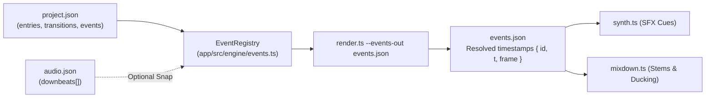

# Visual Event Registry & Musical Downbeat Snapping

**Platform Version**: v0.7.0  
**Implementation File**: [`app/src/engine/events.ts`](../../app/src/engine/events.ts)  
**Export CLI**: `bun scripts/render.ts video --events-out events.json`  

---

## 1. Overview

The **Visual Event Registry** establishes a deterministic bridge between the visual timeline (scene entrances, transition cuts, in-scene choreographies) and downstream sound systems (procedural SFX and multi-track audio mixdown).

In traditional workflows, audio designers manually nudge stems in a DAW whenever an editor trims 12 frames from a scene cut. In **f(x) Studio**, picture events have semantic IDs (e.g. `T2.speedo_shatter`, `hero_reveal`). Sound stems and procedural SFX recipes bind directly to these event IDs. When scene durations or transition cuts shift, sound cues follow the picture automatically with sample-accurate precision.



---

## 2. Event Definition Schema (`EventDef`)

Events can be declared globally in the project manifest (`project.json`) or emitted locally by scenes.

### 2.1 Anchor Types
An event definition must specify **exactly one anchor**:

```typescript
export interface EventDef {
  id: string;
  /** Absolute project time (s) */
  at?: number;
  /** Timeline entry id; time = entry.start (or entry.end with from: 'end') */
  entry?: string;
  /** Transition id; time = window start (or end with from: 'end') */
  transition?: string;
  /** Anchor edge: 'start' (default) or 'end' */
  from?: 'start' | 'end';
  /** Seconds added to the anchor timestamp */
  offset?: number;
  /** Snap to nearest musical downbeat */
  snap?: boolean | EventSnap;
}
```

### 2.2 Musical Downbeat Snapping (`snap`)
When designing rhythmic cuts or punch-ins, graphics cuts often look best aligned precisely to the music's downbeats.
Setting `"snap": true` (or specifying a custom tolerance) snaps the event to the nearest downbeat timestamp in `audio.json`:

```json
{
  "id": "drop_impact",
  "transition": "t-beat-drop",
  "offset": 0.0,
  "snap": {
    "to": "downbeat",
    "tolerance": 0.15
  }
}
```
*If a downbeat exists within $\pm 0.15\,\text{s}$, the resolved time shifts to the exact downbeat.*

---

## 3. Scene-Local Event Registration (`SceneEventDef`)

Scenes can emit internal semantic events authored in scene-local seconds ($0 = \text{entry start}$):

```typescript
// Inside scene setup:
ctx.events.register('act2_speedometer', [
  { id: 'gauge_needle_peak', local: 4.25, snap: true },
  { id: 'gauge_glass_crack', local: 6.80 },
]);
```

When resolved, `local` timestamps are converted into global project time $t = \text{entry.start} + \text{local}$.

---

## 4. Exporting the Resolved Event Table (`events.json`)

To resolve and dump all active events for the current project timeline:

```bash
bun scripts/render.ts video --project brand_campaign --events-out out/events.json
```

### Schema of `out/events.json`:
```json
{
  "events": [
    {
      "id": "T0.ignition",
      "t": 0.0,
      "frame": 0
    },
    {
      "id": "act1_intro_end",
      "t": 8.50,
      "frame": 510
    },
    {
      "id": "gauge_needle_peak",
      "t": 11.75,
      "frame": 705,
      "raw": 11.71
    }
  ]
}
```
*(The `raw` field is included whenever downbeat snapping adjusted the original authored time).*

---

## 5. Downstream Consumption

### In Procedural SFX Synthesis (`synth.ts`):
Cues in `sfx_cues.json` bind to `eventId`:
```json
{
  "id": "glass_crack_cue",
  "recipe": "tick",
  "eventId": "gauge_glass_crack",
  "params": { "freq": 4800, "count": 2 }
}
```

### In Multi-Track Mixdown (`mixdown.ts`):
Audio stems and ducking gates in `mix.json` bind to `eventId`:
```json
{
  "id": "sub_impact",
  "file": "stems/sub_drop.wav",
  "bus": "sub",
  "eventId": "drop_impact",
  "gainDb": -2.0
}
```
