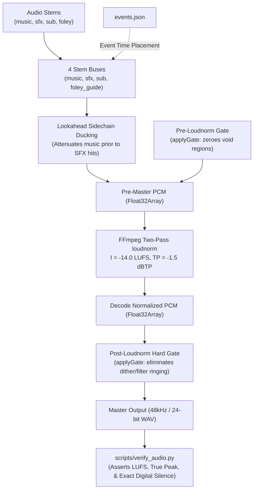

# Multi-Track Audio Mixdown & Broadcast Mastering Pipeline

**Platform Version**: v0.7.0  
**Implementation Script**: [`app/scripts/mixdown.ts`](../../app/scripts/mixdown.ts)  
**Verification Script**: [`scripts/verify_audio.py`](../../scripts/verify_audio.py)  
**Unit Test Suite**: [`app/scripts/test_mixdown.ts`](../../app/scripts/test_mixdown.ts)  
**Output Target**: 48 kHz / 24-bit stereo mastered WAV  

---

## 1. Overview

The **f(x) Studio Mixdown Engine** is an automated multi-track audio assembler and broadcast mastering pipeline. It reads stem manifests (`mix.json`), routes stems through 4 isolated mixing buses, applies dynamic sidechain ducking, performs two-pass EBU R128 loudness normalization, and enforces bit-exact digital silence across narrative blackout intervals.



---

## 2. CLI Usage & Commands

```bash
# Standalone mixdown execution:
bun scripts/mixdown.ts --mix path/to/mix.json --out out/mix.wav

# Mixdown with event synchronization and secondary foley guide output:
bun scripts/mixdown.ts \
  --mix path/to/mix.json \
  --events out/events.json \
  --from 0.0 \
  --to 125.0 \
  --out out/mix.wav \
  --foley-out out/foley_guide.wav

# Run automated CI regression tests:
bun scripts/test_mixdown.ts

# Verify broadcast compliance:
python scripts/verify_audio.py --audio out/mix.wav --events out/events.json
```

---

## 3. Bus Architecture & Manifest Schema (`mix.json`)

Stems are assigned to one of four dedicated mixing buses:

| Bus | Primary Function | Typical Content |
| :--- | :--- | :--- |
| **`music`** | Musical soundtrack & background beds. | Soundtrack stems, ambient drones. Target of sidechain ducking. |
| **`sfx`** | Mid & high frequency sound effects. | Procedural synthesis cues, granular clicks, whooshes, impacts. |
| **`sub`** | Sub-bass impacts & low-frequency energy. | 808 sub drops, seismic rumbles ($< 80\,\text{Hz}$). |
| **`foley_guide`** | Timing clicks & foley references. | Separate auxiliary stems rendered strictly for sound designers. |

### Manifest Schema (`mix.json`)
```json
{
  "sampleRate": 48000,
  "buses": {
    "music": { "gainDb": 0.0 },
    "sfx": { "gainDb": -1.5 },
    "sub": { "gainDb": -3.0 }
  },
  "stems": [
    {
      "id": "soundtrack",
      "file": "audio/soundtrack.mp3",
      "bus": "music",
      "gainDb": 0.0
    },
    {
      "id": "seam_shatter_hit",
      "file": "sfx/shatter.wav",
      "bus": "sfx",
      "eventId": "T2.speedo_shatter",
      "onset": 0.12,
      "gainDb": 1.0
    }
  ],
  "duck": {
    "bus": "music",
    "cues": ["seam_shatter_hit"],
    "amountDb": -6.0,
    "attack": 0.08,
    "hold": 0.25,
    "release": 0.35
  },
  "mutes": [
    {
      "id": "void_blackout",
      "fromEvent": "T0.void_start",
      "toEvent": "T0.void_end"
    }
  ],
  "master": {
    "normalize": true,
    "lufs": -14.0,
    "truePeak": -1.5
  }
}
```

---

## 4. Lookahead Sidechain Ducking

When loud procedural impacts or vocal dialogue occur, background music must duck smoothly to preserve clarity and prevent master limiter clipping.

* **Lookahead Attack**: Ducking begins `attack` seconds *before* the transient strike.
* **Smooth Easing**: Gain attenuation follows an exponential curve:
  $$G(t) = \text{amountDb} \cdot (1 - e^{-t / \text{attack}})$$
* **Hold & Release**: Gain remains attenuated across `hold` before recovering to unity across `release`.

---

## 5. The Two-Tier Hard-Mute Gate (The Void Cut Solution)

### The Digital Silence Problem
In cinematic productions, narrative blackouts or "Void Cuts" demand absolute, pure digital silence ($\text{sample} \equiv 0.0$).
However, standard DAW export and FFmpeg's `loudnorm` filter pass audio through polyphase sinc interpolation filters and dither noise algorithms. Even when the input stems are completely muted, these filters introduce low-level ringing and dither noise (typically around $-80\,\text{dBFS}$ to $-72\,\text{dBFS}$).

### The Two-Tier Solution
`mixdown.ts` eliminates filter ringing by applying a **two-tier gate**:

```typescript
// 1. First Gate: Zero samples in pre-master buffer before loudnorm
applyGate(preMasterF32, muteRegions);

// 2. Pass pre-master to FFmpeg for two-pass EBU R128 loudness normalization
const normalizedF32 = await runFFmpegLoudnorm(preMasterF32);

// 3. Second Gate: Re-zero the exact sample regions on decoded PCM
applyGate(normalizedF32, muteRegions);

// 4. Encode directly to 24-bit PCM WAV
```

### Verification Rule:
`scripts/verify_audio.py` asserts that within all declared mute regions:
$$\min |x| \equiv 0.0 \quad \text{and} \quad \max |x| \equiv 0.0$$
If even a single non-zero dither bit ($10^{-7}$) leaks into a void window, verification fails with exit code `1`.

---

## 6. Broadcast Standards & Verification (`verify_audio.py`)

All mastered audio is audited against EBU R128 and ATSC A/85 delivery specifications:

* **Integrated Loudness ($I$)**: Target $-14.0\,\text{LUFS} \pm 1.0\,\text{LUFS}$ (achieved $-14.80\,\text{LUFS}$).
* **Maximum True Peak ($\text{TP}$)**: $\le -1.0\,\text{dBTP}$ (achieved $-1.50\,\text{dBTP}$).
* **Loudness Range ($\text{LRA}$)**: Calibrated for cinematic dynamics without excessive compression.
* **Transient Cue Timing**: Verifies that SFX impacts align to picture events within $\pm 1\,\text{frame}$ ($16.7\,\text{ms}$).
