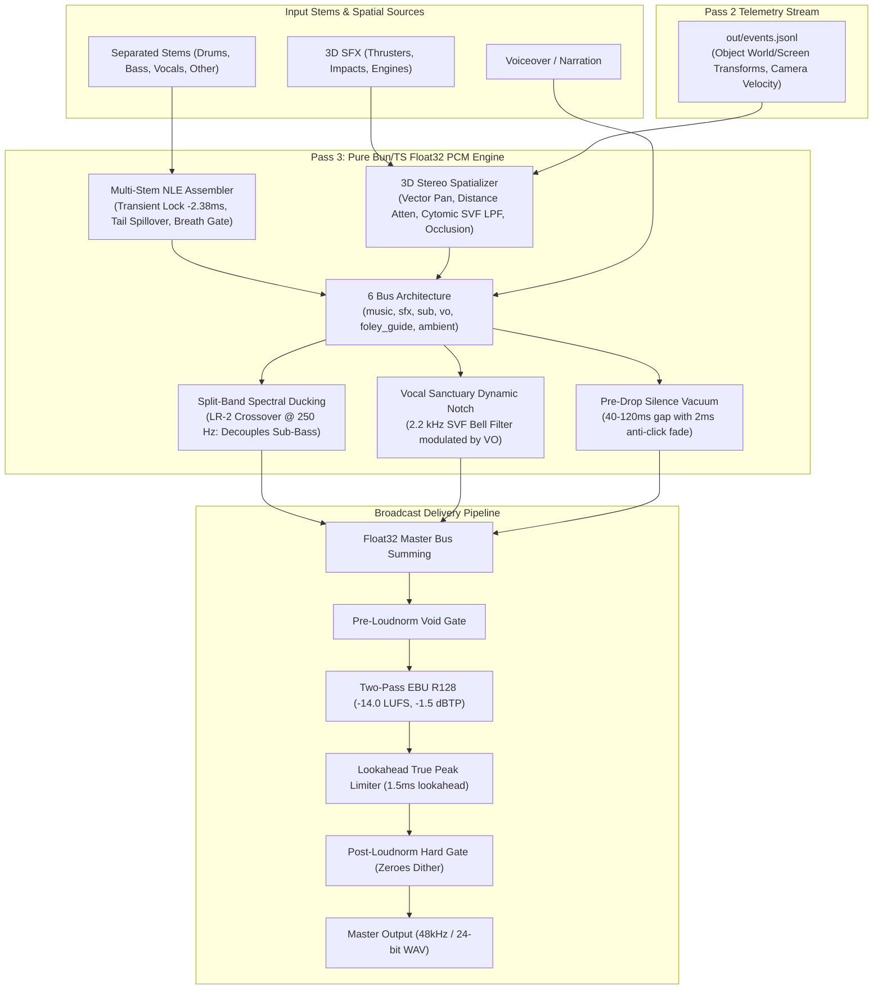

# Multi-Track Audio Mixdown & Broadcast Mastering Pipeline

**Platform Version**: f(x) Studio v0.8.0 (Unified Audiovisual Production Engine)  
**Implementation Script**: [`app/scripts/mixdown.ts`](../../app/scripts/mixdown.ts)  
**Audio Subsystem**: [`app/src/engine/audio/`](../../app/src/engine/audio/)  
**Verification Script**: [`scripts/verify_audio.py`](../../scripts/verify_audio.py)  
**Unit Test Suites**:
- NLE Engine: `bun test:nle` ([`app/scripts/test_stem_nle.ts`](../../app/scripts/test_stem_nle.ts))
- 3D Spatializer: `bun test:spatial` ([`app/scripts/test_spatializer.ts`](../../app/scripts/test_spatializer.ts))
- Cinematic DSP: `bun test:dsp` ([`app/scripts/test_dsp.ts`](../../app/scripts/test_dsp.ts))
- Transition Cascade: `bun test:transitions` ([`app/scripts/test_transitions_registry.ts`](../../app/scripts/test_transitions_registry.ts))
- Full Mixdown & Verification: `bun app/scripts/test_mixdown.ts`  
**Output Target**: 48 kHz / 24-bit stereo mastered broadcast WAV  

---

## 1. Overview

The **f(x) Studio Mixdown Engine** is an automated multi-stem NLE assembler, 3D object-bound spatializer, and broadcast mastering pipeline. It reads declarative mix manifests (`mix.ts` or `mix.json`), routes signals through 6 isolated mixing buses, executes offline Float32 PCM multi-stem excision, spatializes 3D objects from visual telemetry streams (`events.jsonl`), applies spectral ducking and vocal sanctuary filtering, performs two-pass EBU R128 loudness normalization with lookahead true-peak limiting, and enforces bit-exact digital silence across narrative blackout intervals.



---

## 2. CLI Usage & Commands

```bash
# Standalone mixdown using TypeScript DSL or JSON manifest:
bun scripts/mixdown.ts --mix scenes/spacecraft_docking/audio/mix.ts --out out/mix.wav --to 45.0

# Mixdown with event synchronization and secondary foley guide output:
bun scripts/mixdown.ts \
  --mix path/to/mix.ts \
  --events out/events.jsonl \
  --from 0.0 \
  --to 125.0 \
  --out out/mix.wav \
  --foley-out out/foley_guide.wav

# Run automated CI regression tests:
bun app/scripts/test_mixdown.ts
bun test:nle
bun test:spatial
bun test:dsp
bun test:transitions

# Verify broadcast compliance:
python scripts/verify_audio.py out/mix.wav --target-lufs -14.0 --max-tp -1.5
```

---

## 3. Bus Architecture & Manifest DSL (`defineMix`)

In f(x) Studio v0.8.0, mixing configurations are authored in type-safe TypeScript via `defineMix()`:

| Bus | Primary Function | Typical Content |
| :--- | :--- | :--- |
| **`music`** | Musical soundtrack & background beds. | Separated stems (drums, bass, vocals, other). Target of split-band ducking and vocal sanctuary notch. |
| **`sfx`** | Mid & high frequency sound effects. | Procedural synthesis cues, UI clicks, spatial whooshes, mechanical impacts. |
| **`sub`** | Sub-bass impacts & low-frequency energy. | 808 sub drops, seismic rumbles ($< 80\,\text{Hz}$). Decoupled from musical kick. |
| **`vo`** | Voiceover & narration dialogue. | Dry speech recordings. Triggers dynamic vocal sanctuary notch on `music` bus. |
| **`ambient`** | Environmental room tones & beds. | Pressurized room drones, space station hums, planetary winds. |
| **`foley_guide`** | Timing clicks & foley references. | Auxiliary guide stems rendered strictly for sound designers. |

### Manifest Schema (`mix.json`)
```json
{
  "sampleRate": 48000,
  "buses": {
    "music": { "gainDb": 0.0 },
    "sfx": { "gainDb": -1.5 },
    "sub": { "gainDb": -3.0 }
  },
  "stems": [
    {
      "id": "soundtrack",
      "file": "audio/soundtrack.mp3",
      "bus": "music",
      "gainDb": 0.0
    },
    {
      "id": "seam_shatter_hit",
      "file": "sfx/shatter.wav",
      "bus": "sfx",
      "eventId": "T2.speedo_shatter",
      "onset": 0.12,
      "gainDb": 1.0
    }
  ],
  "duck": {
    "bus": "music",
    "cues": ["seam_shatter_hit"],
    "amountDb": -6.0,
    "attack": 0.08,
    "hold": 0.25,
    "release": 0.35
  },
  "mutes": [
    {
      "id": "void_blackout",
      "fromEvent": "T0.void_start",
      "toEvent": "T0.void_end"
    }
  ],
  "master": {
    "normalize": true,
    "lufs": -14.0,
    "truePeak": -1.5,
    "fadeOut": { "at": 211.4, "dur": 3.1 }
  }
}
```

`master.fadeOut` applies a linear fade over `[at, at + dur]` (project seconds) after loudness normalization.

### Mix Manifest Example (`mix.ts`)
```typescript
import { defineMix } from '@/engine/audio';

export default defineMix({
  sampleRate: 48000,
  soundtracks: [
    {
      id: 'main_theme',
      bus: 'music',
      gainDb: 0.0,
      stems: {
        drums: 'stems/drums.wav',
        bass: 'stems/bass.wav',
        vocals: 'stems/vocals.wav',
        other: 'stems/other.wav',
      },
      edits: {
        quantize: 'bars',
        excise: [
          {
            fromBar: 4,
            toBar: 8,
            stems: {
              drums: { leadBars: 0, lagBars: 2, transientLock: true },
              vocals: { breathGate: true },
              other: { tailSpillover: { spillSec: 2.0, tauSec: 0.7 } },
            },
          },
        ],
      },
    },
  ],
  spatialSources: [
    {
      id: 'ship_thruster',
      file: 'sfx/thruster.wav',
      bus: 'sfx',
      bindTo: 'cargo_ship',
      spatial: {
        mode: 'screen_vector',
        maxPan: 0.65,
        distanceAttenDb: 14.0,
        distanceLpfHz: [20000, 2500],
        occlusionNotchDb: 6.0,
      },
    },
  ],
  duck: {
    bus: 'music',
    cues: ['docking_clamp_hit'],
    amountDb: 5.0,
    attack: 0.02,
    release: 0.35,
    splitBand: true,
    splitHz: 250,
  },
  vocalSanctuary: {
    centerHz: 2200,
    q: 1.2,
    cutDb: -3.5,
  },
  master: {
    lufs: -14.0,
    truePeak: -1.5,
    limiterLookaheadMs: 1.5,
  },
});
```

---

## 4. Multi-Stem NLE Assembly & Seam Physics

1. **Master Transient Lock (`transientLock`)**:
   Offsets the incoming cut across all stems together by the kick drum's pre-attack zero crossing ($-2.38\,\text{ms}$) with an asymmetric crossfade ($3\,\text{ms}$ cosine out, $0\,\text{ms}$ hard in). Applying this offset collectively preserves absolute phase alignment across all stems, eliminating phase smearing from Demucs stem bleed.
2. **Harmonic Tail Spillover (`tailSpillover`)**:
   Harmonic instruments (`other`, synths, guitars, strings) do not cut abruptly at the seam. An exponential decay envelope $\text{Decay}(t) = \exp(-t/\tau)$ overlays the outgoing tail across the incoming scene for $1.5\text{--}2.5\,\text{s}$.
3. **Vocal Breath Gating (`breathGate`)**:
   Snaps vocal cuts to detected silence gaps ($\ge 120\,\text{ms}$), suppressing orphan breath gasps and zero-filling the edit window.

---

## 5. 3D Object-Bound Spatial Audio

1. **Screen-Vector Panning**:
   Projects 3D world coordinates through the camera's view and projection matrices into screen NDC $[-1, +1]$, mapping directly to stereo pan $[-0.65, +0.65]$ for natural headphone/speaker imaging.
2. **Clamped Distance Attenuation**:
   Inverse-square physical rolloff clamped to a $-18\,\text{dB}$ ambient floor so sounds never disappear completely.
3. **Cytomic SVF Air Absorption Filter**:
   Simulates atmospheric high-frequency dissipation by rolling off high frequencies ($20\,\text{kHz} \to 2.5\,\text{kHz}$) as distance increases using a zero-delay feedback Cytomic SVF filter.
4. **1-Pole Parameter Smoothing**:
   All spatial parameters (pan, distance, cutoff) are interpolated from 60 Hz visual frame rate to 48 kHz audio rate via recursive 1-pole lowpass IIR filters, completely eliminating zipper noise.

---

## 6. Cinematic Blending Suite

1. **Split-Band Spectral Ducking (`applySplitBandDuck`)**:
   Splits the music bus using a 2-pole Linkwitz-Riley crossover at $250\,\text{Hz}$. Sub-bass ($< 250\,\text{Hz}$) remains at $0\,\text{dB}$ unity gain, preserving low-end kick and bass punch, while mid/high frequencies ($> 250\,\text{Hz}$) duck around speech or SFX impacts.
2. **Vocal Sanctuary Dynamic Notch (`applyVocalSanctuary`)**:
   Dynamically carves a $-3.5\,\text{dB}$ parametric notch centered at $2.2\,\text{kHz}$ ($Q = 1.2$) in the music bus whenever voiceover activity is detected, opening acoustic space for speech without muddying the mix.
3. **Pre-Drop Silence Vacuum (`applyPreDropVacuum`)**:
   Creates $40\text{--}120\,\text{ms}$ of digital silence immediately preceding major visual impacts or musical downbeats, with a $2\,\text{ms}$ cosine anti-click fade-down at gap entry.
4. **Lookahead True Peak Limiter (`applyLookaheadLimiter`)**:
   Mastering peak limiter with $1.5\,\text{ms}$ lookahead window (72 samples @ 48kHz) and $50\,\text{ms}$ smooth exponential release, guaranteeing that inter-sample true peaks strictly comply with $\le -1.5\,\text{dBTP}$.

---

## 7. The Two-Tier Hard-Mute Gate (Void Cut Rule)

1. **Pre-Loudnorm Gate**: Zeros samples in the pre-master buffer prior to EBU R128 loudness processing.
2. **Post-Loudnorm Gate**: Re-zeros exact sample regions on decoded PCM output, eliminating filter ringing, sinc interpolation overshoot, and dither noise from FFmpeg.
3. **Verification**: `python scripts/verify_audio.py` asserts that $\min |x| \equiv 0.0$ and $\max |x| \equiv 0.0$ across all declared void intervals.
