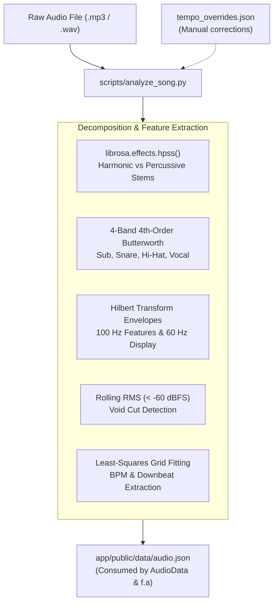

# Offline Acoustic Song Analysis Pipeline

**Platform Version**: v0.7.0  
**Implementation Script**: [`scripts/analyze_song.py`](../../scripts/analyze_song.py)  
**Test Suite**: [`scripts/test_analyze_song.py`](../../scripts/test_analyze_song.py)  
**Output Target**: `app/public/data/audio.json`  

---

## 1. Overview

The offline song analysis pipeline extracts multi-band spectral features, continuous loudness envelopes, and musical downbeat grids from raw audio tracks (`.mp3` or `.wav`). 

Rather than computing FFTs on the browser rendering thread (which introduces frame timing jitter and non-deterministic playback drift), all acoustic features are precomputed offline and serialized into a deterministic JSON asset (`audio.json`). The runtime engine and timeline drivers sample this file with microsecond precision.



---

## 2. CLI Usage & Arguments

```bash
# Basic extraction:
python scripts/analyze_song.py --audio song/track.mp3 --out app/public/data/audio.json

# Production extraction with timing offsets and verification:
python scripts/analyze_song.py \
  --audio song/track.mp3 \
  --out app/public/data/audio.json \
  --duration 125.0 \
  --start 0.0 \
  --offset 0.0 \
  --tempo-overrides tempo_overrides.json \
  --verify
```

### Command-Line Arguments:
| Argument | Type | Default | Description |
| :--- | :--- | :--- | :--- |
| `--audio <path>` | file path | *Required* | Path to input audio track (`.mp3`, `.wav`, `.flac`). |
| `--out <path>` | file path | *Required* | Destination path for serialized acoustic metadata. |
| `--duration <sec>` | float | Audio length | Total timeline duration in seconds mapped to the project. |
| `--start <sec>` | float | `0.0` | Video timeline timestamp where the audio begins playing. |
| `--offset <sec>` | float | `0.0` | Offset into the raw audio file that corresponds to `--start`. |
| `--tempo-overrides <path>` | file path | `None` | Path to manual segment overrides (`tempo_overrides.json`). |
| `--verify` | flag | `false` | Prints tempo maps, silence blocks, and downbeat intervals to terminal. |

---

## 3. Analysis Mechanics

### 3.1 Harmonic-Percussive Source Separation (HPSS)
The pipeline runs `librosa.effects.hpss()` to split the audio into:
* **Harmonic Component ($H$)**: Used for pitch contour tracking and melodic onset detection.
* **Percussive Component ($P$)**: Used for onset strength envelopes and percussive transient detection.

### 3.2 4-Band Butterworth Frequency Decomposition
The signal is filtered into four discrete acoustic frequency registers using 4th-order Butterworth filters (`scipy.signal.butter`):
1. **Sub-Bass / Kick ($30\text{--}120\,\text{Hz}$)**: Isolates bass drum transients and 808 sub drops.
2. **Mid-Range / Snare ($200\text{--}2,500\,\text{Hz}$)**: Captures snare body, rimshots, and hand claps.
3. **High-Frequency / Hi-Hat ($5,000\text{--}16,000\,\text{Hz}$)**: Isolates hats, shakers, ride cymbals, and acoustic air.
4. **Vocal Register / Speech ($300\text{--}3,400\,\text{Hz}$)**: Captures speech fundamental frequencies and vocal syllable attacks.

### 3.3 Multi-Resolution Envelopes
To serve both high-precision physics solvers and standard 60 fps display refresh rates, the script produces dual envelope arrays:
* **`features` (100 Hz)**: Normalized $[0.0, 1.0]$ Hilbert analytic envelopes sampled at $10\text{ ms}$ intervals for `rms`, `low`, `mid`, `high`, `vocal`, `drums`, and `bass`.
* **`envelopes` (60 Hz)**: Continuous RMS loudness and spectral centroid curves pre-aligned to 60 fps display frames.

### 3.4 Silence & Void Detection
The script measures 20 ms rolling RMS with a 10 ms hop. Any interval falling below `SILENCE_DB` ($-60.0\,\text{dBFS}$) for at least `SILENCE_MIN_S` ($0.5\,\text{s}$) is cataloged under `silences`. These silence regions directly feed the Void Cut digital silence hard gate in mixdown.

---

## 4. Tempo Overrides Schema (`tempo_overrides.json`)

When music contains rubato sections, tempo changes, or complex meter shifts, automated beat tracking may drift. You can provide an overrides file via `--tempo-overrides`:

```json
{
  "segments": [
    {
      "start": 0.0,
      "end": 18.81,
      "bpm": 128.0,
      "first_beat": 0.05,
      "bar_phase": 0
    },
    {
      "start": 18.81,
      "end": 64.20,
      "bpm": 132.5,
      "first_beat": 18.86,
      "bar_phase": 0
    }
  ]
}
```

### Segment Override Fields:
* `start` / `end` (float): Timeline bounds in seconds for this tempo segment.
* `bpm` (float): Exact metronome BPM for the segment.
* `first_beat` (float, optional): Timestamp of the first quarter-note beat anchor in the segment.
* `bar_phase` (integer, $0\text{--}3$): Downbeat alignment ($0$ = beat 1 is measure start).

---

## 5. Output Schema (`audio.json`)

```json
{
  "bpm": 128.0,
  "duration": 120.0,
  "beats": [0.0, 0.469, 0.938, 1.406, 1.875],
  "downbeats": [0.0, 1.875, 3.750, 5.625],
  "sections": [
    { "start": 0.0, "end": 18.81, "kind": "intro" },
    { "start": 18.81, "end": 54.00, "kind": "verse" }
  ],
  "silences": [
    [64.50, 66.20]
  ],
  "tempo_map": [
    {
      "start": 0.0,
      "end": 18.81,
      "bpm": 128.0,
      "bar_phase": 0,
      "source": "override"
    }
  ],
  "features": {
    "rms": [0.0, 0.12, 0.85, ...],
    "low": [0.0, 0.45, 0.98, ...],
    "mid": [0.0, 0.10, 0.35, ...],
    "high": [0.0, 0.05, 0.12, ...]
  },
  "envelopes": {
    "fps": 60,
    "rms": [0.02, 0.14, 0.82, ...],
    "centroid": [1200.5, 1450.2, 2800.0, ...]
  },
  "onsets": [0.469, 0.938, 1.406]
}
```

---

## 6. Verification Suite

Run the unit test suite to verify envelope extraction and override handling:

```bash
python scripts/test_analyze_song.py
```
Outputs exit code `0` on successful regression validation.
