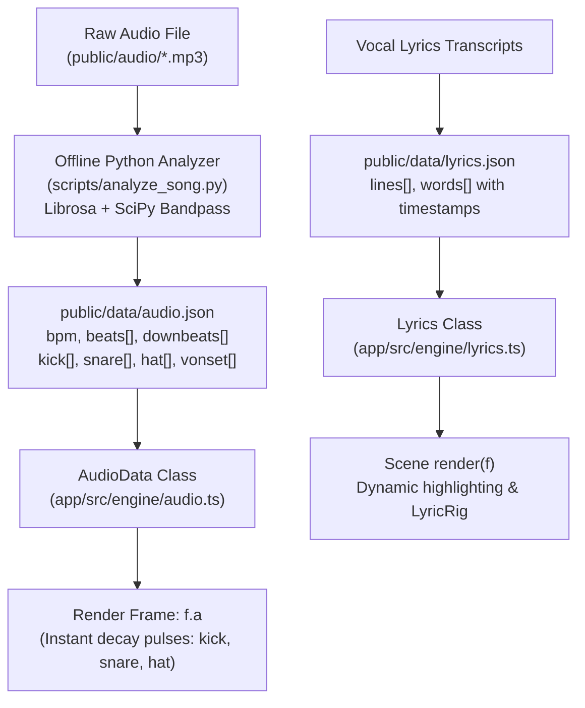

# Audio, Music & Speech Synchronization Pipeline

This guide details the audio analysis, multi-band frequency decomposition, transient detection, and speech synchronization systems in **f(x) Studio**.

Whether timing a commercial reveal to acoustic sound design, synchronizing 3D camera punch-ins to heavy kick drum drops, or animating karaoke typography to vocal tracks, the engine delivers deterministic audio metadata down to the millisecond.

---

## 1. System Architecture: Offline Analysis to Runtime Evaluation

Audio evaluation in f(x) Studio is split into two phases:
1. **Offline Acoustic Decomposition (`scripts/analyze_song.py`)**: A Python pipeline using **Librosa** and **SciPy** decomposes the raw audio file (`.mp3` / `.wav`) into continuous multi-band spectral envelopes and musical beat grids, saving the result to `public/data/audio.json`.
2. **Deterministic Runtime Ingestion (`AudioData` / `f.a`)**: The engine loads `audio.json` at startup. During `render(f)`, every scene receives instant, pre-computed envelope values and decay pulses synchronized to timeline time $f.t$.



---

## 2. The Offline Analysis Pipeline (`scripts/analyze_song.py`)

To generate or refresh `audio.json` for a new song or voiceover track:

```bash
# Requires: pip install numpy scipy librosa
python scripts/analyze_song.py --audio app/public/audio/soundtrack.mp3 --out app/public/data/audio.json --duration 60.0 --start 0.0 --offset 0.0
```

### CLI Parameters:
* `--audio <path>`: Path to input audio track (`.mp3` or `.wav`).
* `--out <path>`: Destination path for extracted metadata JSON (default: `app/public/data/audio.json`).
* `--duration <seconds>`: Total video timeline duration in seconds.
* `--start <seconds>`: Timestamp in video timeline where audio begins.
* `--offset <seconds>`: Offset into the raw audio file to start extraction from.

### Analysis Mechanics:
1. **Tempo & Beat Tracking**:
   - Computes onset strength envelopes using `librosa.onset.onset_strength`.
   - Extracts global tempo (BPM) and discrete timestamp arrays for musical downbeats ($1.1, 2.1, \dots$) and quarter-note beats ($1.2, 1.3, \dots$).
2. **4-Band Butterworth Frequency Decomposition**:
   - The audio signal is filtered through four separate 4th-order Butterworth bandpass filters:
     * **Sub-Bass / Kick ($30\text{–}120\,\text{Hz}$)**: Isolates kick drums and sub-bass drops.
     * **Mid-Range / Snare ($200\text{–}2,500\,\text{Hz}$)**: Isolates snare snaps, claps, and rimshots.
     * **High-Frequency / Hi-Hat ($5,000\text{–}16,000\,\text{Hz}$)**: Isolates hi-hats, shakers, and acoustic sizzle.
     * **Vocal Onset / Speech ($300\text{–}3,400\,\text{Hz}$)**: Isolates vocal syllable starts and spoken transients.
3. **Hilbert Envelope Extraction**:
   - Applies the Hilbert transform to extract the instantaneous analytic envelope, normalized to $[0.0, 1.0]$ and sampled at $100\,\text{Hz}$ across the timeline.

### Schema of `public/data/audio.json`
```json
{
  "bpm": 129.20,
  "duration": 125.0,
  "beats": [0.0, 0.464, 0.928, 1.393, 1.857, 2.321],
  "downbeats": [0.0, 1.857, 3.715, 5.572],
  "kick": [0.0, 0.12, 0.98, 0.45, 0.08, 0.0],
  "snare": [0.0, 0.05, 0.10, 0.95, 0.32, 0.0],
  "hat": [0.0, 0.85, 0.20, 0.10, 0.78, 0.15],
  "vonset": [0.0, 0.0, 0.65, 0.92, 0.14, 0.0]
}
```

---

## 3. In-Engine Audio Queries (`AudioData` & `f.a`)

Every scene receives pre-calculated audio telemetry inside the `Frame` object:

### 3.1 Instant Transient Pulses (`f.a`)
The `f.a` object delivers instantaneous, exponential-decay transient pulses normalized to $0.0 \to 1.0$:

```typescript
// Inside scene render(f):
const kick = f.a.kick;   // 1.0 on kick drum strike, decaying to 0.0
const snare = f.a.snare; // 1.0 on snare strike, decaying to 0.0
const hat = f.a.hat;     // High-frequency sizzle envelope
const voice = f.a.vonset; // Vocal onset transient pulse
```

### 3.2 Continuous Musical Clock Signals
The `Frame` object calculates continuous musical time coordinates:
- `f.beat`: Continuous float beat counter (e.g., $14.25$ beats into the song).
- `f.bar`: Continuous float measure counter (e.g., $3.56$ bars into the song).
- `f.beatPhase`: Sawtooth wave running $0.0 \to 1.0$ across each individual beat.
- `f.barPhase`: Sawtooth wave running $0.0 \to 1.0$ across each measure.

### 3.3 Deep Audio Queries (`ctx.audio`)
For non-local or predictive queries:
```typescript
// Query if a kick drum transient occurred within the last 50ms
const nearKick = ctx.audio.hitAt(f.t, 'kick', 0.05);

// Get the timestamp of the next upcoming downbeat
const nextDownbeat = ctx.audio.nextDownbeat(f.t);
```

---

## 4. Vocal Lyrics Synchronization (`Lyrics` & `lyrics.json`)

For productions featuring synchronized vocal text, `Lyrics` (`app/src/engine/lyrics.ts`) manages word-level karaoke timing.

### Schema of `public/data/lyrics.json`
```json
{
  "lines": [
    {
      "start": 3.71,
      "end": 7.42,
      "text": "This could crash and burn and maybe it'll work",
      "words": [
        { "text": "This", "start": 3.71, "end": 4.10 },
        { "text": "could", "start": 4.10, "end": 4.50 },
        { "text": "crash", "start": 4.50, "end": 5.15 },
        { "text": "and", "start": 5.15, "end": 5.40 },
        { "text": "burn", "start": 5.40, "end": 6.10 }
      ]
    }
  ]
}
```

### Lyrics Query API
```typescript
// 1. Get the current active vocal line
const line = ctx.lyrics.getLineAt(f.t);

// 2. Get the current active sung word
const word = ctx.lyrics.getWordAt(f.t);

// 3. Compute continuous word progress [0.0 to 1.0] for smooth character fills
if (word) {
  const progress = Lyrics.wordProgress(word, f.t);
  // progress = clamp((f.t - word.start) / (word.end - word.start), 0, 1)
}
```

---

## 5. Timeline Drivers (`driver.ts`)

f(x) Studio decouples animation time from the physical clock using **Timeline Drivers**:

1. **`ClockDriver`**:
   - Drives animation via pure numerical timestamps.
   - Used for silent procedural motion graphics, UI interaction showcases, and **deterministic headless offline export** (`scripts/render.ts`).
   - Completely immune to audio buffer underruns, sound card latency, or browser audio permission dialogs.
2. **`AudioDriver`**:
   - Synchronizes animation to the HTML5 Audio or Web Audio playback clock.
   - Used during interactive browser playback (`http://localhost:5173`) to guarantee that visuals stay phase-locked to speaker sound.
3. **`SpeechDriver`**:
   - Drives animation based on speech synthesis phoneme events and voiceover pause boundaries.

---

## 6. Practical Motion Design Recipes

### Recipe A: Camera Punch-In on Kick Drums
```typescript
// Create an organic camera kick on every bass drop
const kickPunch = Math.pow(f.a.kick, 2.0) * 0.40; // Non-linear quadratic impact
ctx.camera.position.z = baseZ - kickPunch;
```

### Recipe B: Dynamic Bloom Pulse with Snare Snaps
```typescript
// Return dynamic post overrides that flare bloom on snare hits
return {
  bloom: 0.18 + 0.12 * f.a.snare,
  trauma: 0.05 * f.a.kick,
};
```

### Recipe C: Audio-Reactive Particle Shockwave
```typescript
// Propel particles outward when a transient strikes
if (f.a.kick > 0.8) {
  particleEmitter.triggerBurst({
    count: 200,
    speed: 12.0 * f.a.kick,
    color: ctx.tokens.signal,
  });
}
```
