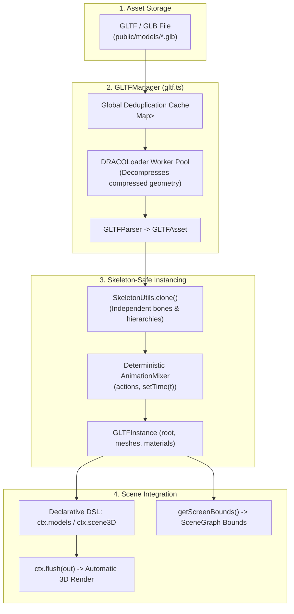

# GLTF & GLB 3D Asset Loading, Instancing & Deterministic Animation

**Platform Version**: v0.5.0+  
**Implementation Files**: [`app/src/engine/gltf.ts`](../../app/src/engine/gltf.ts), [`app/src/engine/dsl.ts`](../../app/src/engine/dsl.ts)  

---

## 1. Overview & Architectural Invariants

Loading external 3D CAD models, vehicle chassis, electronic hardware, or rigged characters in a procedural motion graphics engine requires strict adherence to engine invariants:

1. **Zero Headless Race Conditions**: Models must be preloaded and parsed during the asynchronous initialization phase (`preload` or declarative `models` map). Asynchronous loading inside `render()` causes Frame 0 to render blank or pop in abruptly during offline video export.
2. **Stateless Closed-Form Animation ($\text{Frame} = f(t)$)**: Standard Three.js code calls `mixer.update(dt)`, which relies on mutable delta-time integration. This drifts over time and breaks under sub-frame adaptive supersampling ($4\text{–}324\,\text{spp}$). `GLTFInstance` provides **`setTime(timeInSeconds)`**, evaluating skeletal bones and keyframe tracks in pure closed form.
3. **Skeleton-Safe Instancing**: Duplicating models via naive Three.js `scene.clone()` breaks skeletal bone bindings. The engine uses `SkeletonUtils.clone` to ensure independent bone hierarchies, materials, and animation playback across multiple instances.
4. **Automatic Normalization & Screen Projection**: Real-world CAD files often export in millimeters or with offsets. `GLTFInstance` provides `center()` and `fitToBox(size)` for instant normalization, plus `getScreenBounds(camera)` to project 3D oriented bounding boxes into 2D screen pixels for automated telemetry collision avoidance (Rule `F04`).



---

## 2. Declarative Scene Integration (`defineScene`)

The simplest and recommended way to use 3D models is via the `models` property in `defineScene`. The engine guarantees that all declared models are loaded, parsed, and instantiated before `setup()` is invoked.

### Full Declarative Example: 3D Product Turntable
```typescript
import * as THREE from 'three';
import { defineScene, type SceneContext } from '../../engine/dsl';
import { cubicEaseInOut } from '../../engine/motion';
import type { Frame } from '../../engine/scene';

export default defineScene({
  id: 'product_cad_reveal',

  // Declarative preloading: Models are fetched and ready before setup() runs
  models: {
    heroProduct: {
      url: '/models/hardware_module.glb',
      center: true,       // Automatically center geometry at (0, 0, 0)
      fit: 4.0,           // Scale largest bounding axis to 4.0 world units
      castShadow: true,
      receiveShadow: true,
      envMapIntensity: 1.2,
    },
  },

  setup(ctx: SceneContext) {
    // 1. Retrieve the pre-instantiated model
    const product = ctx.getModel('heroProduct')!;

    // 2. Add model root directly to the 3D scene container
    ctx.scene3D.add(product.root);

    // 3. Studio lighting rig
    const keyLight = new THREE.DirectionalLight(0xFFFFFF, 2.5);
    keyLight.position.set(5, 8, 5);
    const rimLight = new THREE.DirectionalLight(0x38BDF8, 4.0); // Cool metallic rim
    rimLight.position.set(-6, 4, -5);
    const ambient = new THREE.AmbientLight(0xFFFFFF, 0.3);

    ctx.scene3D.add(keyLight, rimLight, ambient);

    // 4. Configure camera lens
    ctx.rig.setLensMm(50);
  },

  render(ctx: SceneContext, f: Frame, out: THREE.WebGLRenderTarget) {
    const product = ctx.getModel('heroProduct')!;

    // 1. Deterministic turntable rotation
    const progress = Math.min(1.0, f.lt / 3.0);
    const ease = cubicEaseInOut(progress);
    product.root.rotation.y = f.lt * 0.4;
    product.root.rotation.x = Math.sin(f.lt * 0.3) * 0.15;

    // 2. Camera glide
    ctx.rig.position = [Math.sin(ease * 0.8) * 7.0, 2.2 - 0.4 * ease, 7.5 - 2.0 * ease];
    ctx.rig.target = [0, 0, 0];
    ctx.updateCamera(f.t, f.p);

    // 3. Project 3D bounding box to 2D screen space to avoid title collisions
    const [minX, minY, maxX, maxY] = product.getScreenBounds(ctx.threeCam, ctx.W, ctx.H);

    // 4. Position typography safely above the 3D model
    ctx.text('spec_label', 'TITANIUM UNIBODY // CHASSIS v4', {
      fontSize: 24,
      fontFamily: 'Inter, sans-serif',
      color: '#FFFFFF',
      align: 'center',
    });
    ctx.renderText('spec_label', ctx.layer2d.ctx, f.t, 960, Math.max(80, minY - 40));

    // 5. MANDATORY: Flush 3D scene, vector batches, and typography to target
    ctx.flush(out, true);

    return {
      bloom: 0.15,
      bloomThreshold: 0.85, // Specular hot spots gleam
      vignette: 0.25,
    };
  },
});
```

---

## 3. Closed-Form Deterministic Animation (`setTime`)

If your GLTF/GLB contains skeletal rigs, character animation, mechanical assemblies, or morph targets:

> [!CAUTION]
> **Never call `mixer.update(dt)`!**  
> `mixer.update(dt)` relies on accumulator state that diverges when scrubbing backwards or evaluating non-chronological sub-frames during adaptive motion blur.

Always use **`model.setTime(t, clipName?, options?)`**:

```typescript
render(ctx: SceneContext, f: Frame, out: THREE.WebGLRenderTarget) {
  const character = ctx.getModel('riggedCharacter')!;

  // Evaluates bones and keyframes deterministically at song/scene time:
  character.setTime(f.lt, 'RunCycle', {
    timeScale: 1.2, // 20% faster playback
    loop: true,
  });

  ctx.flush(out);
}
```

Because `setTime()` directly calls Three.js `AnimationMixer.setTime()`, scrubbing back and forth across the timeline evaluates bit-identical poses without jitter or drift.

---

## 4. Imperative Usage in Raw `Scene` Subclasses

For low-level custom scenes subclassing `Scene` directly, use `GLTFManager`:

```typescript
import * as THREE from 'three';
import { Scene, type SceneCtx, type Frame } from '../../engine/scene';
import { GLTFManager, type GLTFInstance } from '../../engine/gltf';

export default class DroneScanScene extends Scene {
  private drone!: GLTFInstance;
  private scene3D = new THREE.Scene();
  private cam3D = new THREE.PerspectiveCamera(45, 16 / 9, 0.1, 100);

  override async init(): Promise<void> {
    // Preload & instantiate with auto-fit
    this.drone = await GLTFManager.instantiate('/models/drone.glb', {
      center: true,
      fit: 3.5,
      castShadow: true,
    });

    this.scene3D.add(this.drone.root);
    this.scene3D.add(new THREE.AmbientLight(0xffffff, 0.4));
  }

  override render(f: Frame, out: THREE.WebGLRenderTarget): void {
    const gl = this.ctx.renderer;

    // 1. Evaluate deterministic propeller animation
    this.drone.setTime(f.lt, 'FlightMotors');

    // 2. Flight path
    this.drone.root.position.set(0, Math.sin(f.lt * 2.0) * 0.4, 0);

    // 3. Render 3D pass
    gl.setRenderTarget(out);
    gl.clear(true, true, true);
    gl.render(this.scene3D, this.cam3D);
    gl.resetState();
  }

  override dispose(): void {
    // Release geometries, textures, and mixer bindings
    this.drone.dispose();
  }
}
```

---

## 5. API Reference: `GLTFInstance` & `GLTFManager`

### `GLTFLoadOptions`
```typescript
export interface GLTFLoadOptions {
  /** Optional custom path to Draco decoder libraries */
  dracoDecoderPath?: string;
  /** Automatically center model geometry at (0, 0, 0) upon instancing */
  center?: boolean;
  /** Automatically fit model bounding box to maximum dimension */
  fit?: number;
  /** Enable castShadow on all child meshes */
  castShadow?: boolean;
  /** Enable receiveShadow on all child meshes */
  receiveShadow?: boolean;
  /** Override environment map intensity across all PBR materials */
  envMapIntensity?: number;
  /** Optional custom material or material mapper */
  material?: THREE.Material | ((mesh: THREE.Mesh, original: THREE.Material) => THREE.Material);
}
```

### `GLTFInstance` Methods
| Method | Description |
| :--- | :--- |
| `setTime(t, clip?, opts?)` | **Closed-form animation evaluation**. Evaluates mixer at timestamp `t` without simulation drift. |
| `play(clip, opts?)` | Activates and configures a specific animation clip action. |
| `center(includeBones?)` | Calculates bounding box and shifts children so visual center sits at $(0, 0, 0)$. |
| `fitToBox(maxDim, includeBones?)` | Uniformly scales the root group so its largest axis equals `maxDim` world units. |
| `getBounds(target?, includeBones?)` | Returns the world-space `THREE.Box3` bounding box. For `SkinnedMesh` characters, `includeBones = true` (default) expands the box to encompass active bone world positions. |
| `getSize(target?, includeBones?)` | Returns the dimensions `[width, height, depth]` in world units. |
| `getScreenBounds(cam, W, H)`| Projects the 3D bounding box (including animated bones) through camera to return 2D pixels `[minX, minY, maxX, maxY]`. |
| `setMaterial(material)` | Overrides materials across all child meshes (useful for wireframe or holographic passes). |
| `traverseMeshes(fn)` | Iterates through all child meshes. |
| `dispose()` | Disposes all cloned geometries, materials, attached textures, and unbinds the animation mixer. |

### `GLTFManager` Static Methods
| Method | Description |
| :--- | :--- |
| `GLTFManager.load(url, opts?)` | Asynchronously loads and caches the master `GLTFAsset`. Deduplicates simultaneous requests. |
| `GLTFManager.instantiate(url, opts?)` | Loads (or fetches from cache) and returns an independent `GLTFInstance`. |
| `GLTFManager.setDracoDecoderPath(path)`| Configures Draco decoder WASM/JS directory (defaults to local `/draco/`). |
| `GLTFManager.clearCache()` | Clears the global asset cache and releases Draco worker threads. |

---

## 6. Best Practices for Production & Telemetry

1. **Host Models in `app/public/models/`**:
   Place `.glb` files under `app/public/models/`. They are served directly by Vite at `/models/name.glb`.
2. **Prefer Binary `.glb` over `.gltf`**:
   Single-file `.glb` bundles contain geometry, embedded buffers, and textures in a single payload, eliminating multi-file HTTP waterfalls.
3. **Local Draco Decoder Bundling for Offline / CI Nodes**:
   The engine bundles the official Draco WebAssembly decoders in `app/public/draco/`. In air-gapped CI environments or headless render nodes without internet access, `GLTFManager` resolves decoders locally from `/draco/`. Remote CDNs can still be specified via `GLTFManager.setDracoDecoderPath('https://...')` or per-asset in `GLTFLoadOptions.dracoDecoderPath`.
4. **Use `getScreenBounds()` with `SceneGraph`**:
   Register projected screen bounds into the SceneGraph so automated telemetry rules (`F04` text collision) detect if 2D typography penetrates the 3D model silhouette. For rigged characters, `getScreenBounds()` automatically accounts for animated bone deformations outside the rest pose.
5. **Always Call `dispose()`**:
   When tearing down scenes or testing in HMR, ensure models are disposed of to avoid WebGL texture and buffer leaks. In declarative scenes, `SceneContext.dispose()` handles this automatically.
