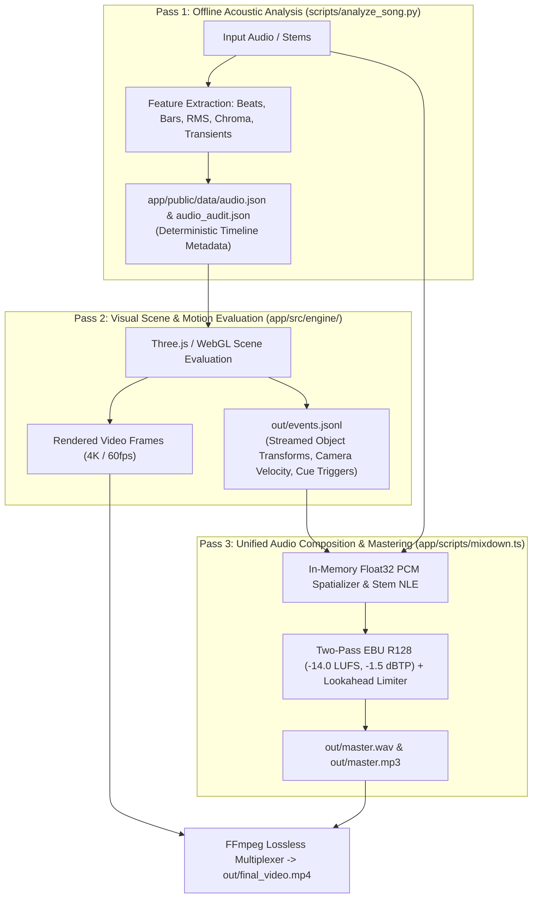

# f(x) Studio v0.8.0 Release Record: Unified Audiovisual Production Engine & Scene-Bound Audio System

**Release Date**: October 31, 2026  
**Version**: `v0.8.0`  
**License**: PolyForm Small Business License 1.0.0 ([`LICENSE.md`](../../LICENSE.MD))  
**Previous Release**: [`v0.7.0 Release Record`](./v0.7.0-release-record.md)  
**Master Architecture Specification**: [`docs/architecture/v0.8.0-unified-audiovisual-production.md`](../architecture/v0.8.0-unified-audiovisual-production.md)  
**Mixdown Specification**: [`docs/audio/mixdown.md`](../audio/mixdown.md)  

---

## 1. Executive Summary

Version `v0.8.0` represents a historic milestone for **f(x) Studio**, expanding the platform from a procedural motion-design and graphics engine into the world’s first **Unified Audiovisual Production Engine**. In v0.8.0, an autonomous AI agent directs visual geometry, 3D camera choreography, separated music stems, and tactile spatial sound design as a single, coordinated production.

Prior to v0.8.0, motion graphics and sound lived on separate, disjointed timelines. Audio was either authored externally in digital audio workstations (DAWs) or stitched together with rigid master-track razor cuts that introduced clicks, phase smearing, and vocal interruptions.

v0.8.0 fundamentally solves this with five core innovations:
1. **The Strict 3-Pass Linear Production Pipeline**: Enforces complete architectural decoupling between offline acoustic analysis (Pass 1), zero-DSP WebGL scene evaluation and telemetry streaming (Pass 2), and pure Bun/TypeScript Float32 PCM spatial audio composition and mastering (Pass 3).
2. **Multi-Stem Non-Linear Editor (NLE) with Master Transient Lock**: Re-engineers musical stems in memory with a master pre-attack kick offset ($-2.38\,\text{ms}$) applied collectively across all stems to eliminate Demucs stem bleed phase smearing, accompanied by asymmetric $3\,\text{ms}$ cosine crossfades, exponential harmonic tail spillover ($\exp(-t/\tau)$), and vocal breath gating ($\ge 120\,\text{ms}$).
3. **Object-Bound 3D Stereo Spatializer & 1-Pole Parameter Smoothing**: Projects 3D world transforms through camera matrices into screen NDC coordinates and stereo panning $[-0.65, +0.65]$, interpolating 60 Hz visual coordinates to 48 kHz audio rate via recursive 1-pole lowpass IIR filters, combined with Cytomic SVF zero-delay feedback air absorption rolloff ($20\,\text{kHz} \to 2.5\,\text{kHz}$).
4. **Cinematic Blending DSP Suite**: Introduces native sub-bass decoupled split-band ducking via a 2-pole Linkwitz-Riley crossover at $250\,\text{Hz}$, dynamic Vocal Sanctuary notch filtering at $2.2\,\text{kHz}$ ($Q = 1.2$, $-3.5\,\text{dB}$) to preserve speech intelligibility, a $1.5\,\text{ms}$ lookahead True Peak mastering limiter enforcing $\le -1.5\,\text{dBTP}$, and pre-drop silence vacuums ($40\text{--}120\,\text{ms}$) with anti-click fades.
5. **The Two-Tier Transition Cascade & Registry**: Establishes a priority resolution cascade where project-local bespoke transitions (`scenes/<project>/transitions/`) take precedence over the global platform library (`transitions/`), verified across both Vite browser bundles and headless Bun CLI runtimes.

---

## 2. The Strict 3-Pass Linear Production Pipeline

To guarantee 100% deterministic, zero-jitter rendering, v0.8.0 strictly eliminates circular render dependencies, real-time polyphonic phase-vocoder pitch shifting, and mesh raycasting for acoustics:



---

## 3. Core Architectural Subsystems

### Subsystem A: Dedicated Engine Audio Architecture (`app/src/engine/audio/`)

v0.8.0 establishes a dedicated engine audio module:

1. **Declarative Mix Manifest DSL (`manifest.ts`)**:
   - `defineMix(config)`: Strongly-typed TypeScript DSL providing compile-time property validation and structural invariants.
   - Enforces valid bus assignments across 6 dedicated mixing buses: `music`, `sfx`, `sub`, `vo`, `foley_guide`, `ambient`.
   - Validates stem paths, pan ranges $[-1.0, +1.0]$, gain dB specifications, excision ranges (`fromBar < toBar`), spatial configs, and mastering thresholds.

2. **Multi-Stem NLE & Timeline Assembly (`stem_nle.ts`)**:
   - `assembleSoundtrackStems(track, audioData, options)`: Pure Float32 PCM timeline reconstruction in Bun/TypeScript memory.
   - **Master Transient Lock (`transientLock`)**: Applies `PRE_ATTACK_KICK_OFFSET_MS = -2.38` ms (~114 samples @ 48kHz) collectively across all stems at the cut seam. Offsetting all stems together preserves cross-stem phase coherence and eliminates comb-filtering from Demucs separation artifacts.
   - **Asymmetric Cosine Crossfades**: Employs a $3\,\text{ms}$ cosine fade-out on outgoing audio and an immediate $0\,\text{ms}$ hard attack on incoming downbeats to preserve transient impact.
   - **Harmonic Tail Spillover (`tailSpillover`)**: Overlays an analytical decay envelope $\text{Decay}(t) = \exp(-t/\tau)$ ($2.0\,\text{s}$ duration, $\tau = 0.7\,\text{s}$) across harmonic stems (`other`, keys, synths, guitars) to allow natural reverberant dissipation across cuts.
   - **Vocal Breath Gating (`breathGate`)**: Analyzes $120\,\text{ms}$ windows preceding cuts to snap edit seams to natural vocal silence intervals, preventing isolated breath gasps or truncated syllables.

3. **1-Pole Parameter Smoothing Bridge (`smoother.ts`)**:
   - `ParameterSmoother`: Bridges discrete 60 Hz visual frame updates ($16.67\,\text{ms}$) to continuous 48 kHz audio rate ($0.0208\,\text{ms}$) using recursive 1-pole lowpass IIR filters:
     $$y[n] = y[n-1] + \alpha (x[n] - y[n-1]), \quad \alpha = 1 - e^{-1 / (f_s \cdot \tau)}$$
   - Applied across stereo pan, distance gain, and filter cutoff frequencies, completely eliminating audible zipper noise during rapid camera pans or whip transitions.

4. **Visual to Audio Telemetry Bridge (`telemetry.ts`)**:
   - `projectWorldToScreenPan(worldPos, viewMatrix, projMatrix, maxPan)`: Pure 4x4 matrix vector arithmetic projecting 3D coordinates into Normalized Device Coordinates (NDC) $[-1, +1]$ and mapping horizontal position to stereo pan $[-0.65, +0.65]$ without Three.js runtime overhead.
   - `AudioTelemetryEmitter`: Scene-side zero-DSP emitter collecting spatial coordinates, velocities, and acoustic tags, and streaming them to NDJSON (`events.jsonl`).
   - `parseTelemetryStream(ndjson)`: High-performance parser deserializing NDJSON telemetry streams during mixdown.

5. **3D Stereo Spatializer (`spatializer.ts`)**:
   - `spatializeSource(pcm, telemetry, config, options)`: Processes dry mono/stereo sound effects into fully spatialized stereo PCM buffers.
   - **Equal-Power Vector Panning**: Constant-power panning law ($\sqrt{\cos\theta}, \sqrt{\sin\theta}$) centered around unity gain.
   - **Clamped Distance Attenuation**: Inverse-square distance law clamped to a $-18\,\text{dB}$ ambient floor so objects never vanish entirely.
   - **Cytomic SVF Air Absorption Filter**: Zero-delay feedback state variable filter rolling off high frequencies ($20\,\text{kHz} \to 2.5\,\text{kHz}$) exponentially with distance:
     $$f_c(d) = f_{\text{min}} + (f_{\text{max}} - f_{\text{min}}) \cdot e^{-d / d_{\text{ref}}}$$
   - **Declarative Occlusion Notching**: Implements a $-6.0\,\text{dB}$ shelf filter centered at $1.2\,\text{kHz}$ when objects are flagged with `occluded: true`.

6. **Cinematic DSP Suite (`dsp.ts`)**:
   - `applyVocalSanctuary(pcm, voEnvelope, options)`: Dynamic Cytomic SVF notch filter centered at $2.2\,\text{kHz}$ ($Q = 1.2$, $-3.5\,\text{dB}$) dynamically modulated by voiceover activity, opening an acoustic pocket for narration.
   - `applySplitBandDuck(pcm, duckEnvelope, options)`: 2-pole Linkwitz-Riley crossover ($Q = 0.5$) at $250\,\text{Hz}$ decomposing audio into Sub-Bass and Mid/High bands. Attenuates Mid/High frequencies while leaving Sub-Bass at $0\,\text{dB}$ unity gain, preserving low-end kick and 808 weight.
   - `applyLookaheadLimiter(pcm, ceilingDb, lookaheadMs, sr)`: Professional mastering limiter with $1.5\,\text{ms}$ lookahead window (72 samples @ 48kHz) using a double-ended monotonic deque for $O(N)$ peak finding and $50\,\text{ms}$ exponential release, strictly guaranteeing true peaks $\le -1.5\,\text{dBTP}$.
   - `applyPreDropVacuum(pcm, dropSample, gapMs, sr)`: Creates $40\text{--}120\,\text{ms}$ of digital silence immediately preceding major visual impacts or drops, with a $2\,\text{ms}$ cosine anti-click fade-down at entry.

---

### Subsystem B: Two-Tier Transition Cascade & Registry (`app/src/engine/transitions/registry.ts`)

v0.8.0 introduces a modular resolution cascade for scene transitions:
- **Tier 1 (Bespoke Project Transitions)**: Evaluates project-local transitions located in `app/src/scenes/<project>/transitions/<name>.ts`.
- **Tier 2 (Global Platform Library)**: Falls back to engine-wide transitions located in `app/src/transitions/<name>.ts`.
- **Dual-Environment Architecture**:
  - Vite Browser Bundle: Discovered via compile-time `import.meta.glob` in `app/src/timeline.ts` and registered into the engine via `setTransitionRegistry`.
  - Headless Bun CLI: Supports manual or mock registry injection via `setTransitionRegistry` for lightning-fast test execution.
- **Actionable Diagnostics**: When a transition module cannot be resolved, throws a diagnostic error listing available transitions across both Tier 1 and Tier 2.

---

### Subsystem C: Unified Acoustic Analysis CLI (`scripts/analyze_song.py --audit`)

The offline analysis CLI was extended with automated acoustic cut auditing:
```bash
python scripts/analyze_song.py --audio song/track.mp3 --stems stems/htdemucs/ --audit --audit-out data/audit.json
```
- Computes bar-by-bar chroma vectors using Librosa STFT and evaluates pairwise cosine similarity between candidate measures.
- Extracts bass fundamental notes ($40\text{--}250\,\text{Hz}$) to ensure musical root match across cut seams.
- Analyzes vocal energy to identify silence gaps ($\ge 120\,\text{ms}$) where speech/vocals can be cleanly excised.
- Measures the kick drum's pre-attack zero crossing offset to ensure precise synchronization with the $-2.38\,\text{ms}$ transient lock standard.
- Exports a candidate cut matrix with overall reliability scoring ($0.0 \dots 1.0$).

---

### Subsystem D: Multi-Track Mixdown & Broadcast Mastering Engine (`app/scripts/mixdown.ts`)

The master audio assembler was expanded to support the complete v0.8.0 production architecture:
- Directly evaluates TypeScript mix manifests (`mix.ts`) exporting `defineMix()`.
- Routes signals through 6 isolated mixing buses with individual gain staging.
- Assembles multi-stem soundtracks via `assembleSoundtrackStems`.
- Ingests visual telemetry streams (`events.jsonl`) to spatialize 3D sources via `spatializeSource`.
- Executes split-band ducking and dynamic vocal sanctuary filtering.
- Two-tier hard-mute gate (`applyGate`): Zeros pre-master buffer before FFmpeg EBU R128 loudnorm, and re-zeros decoded PCM output to permanently eliminate polyphase filter ringing and dither noise.
- Enforces True Peak limits via `applyLookaheadLimiter` before outputting 48 kHz / 24-bit broadcast WAV files.

---

### Subsystem E: The Autonomous Benchmark (`app/src/scenes/spacecraft_docking/`)

To validate that an autonomous AI agent can direct an end-to-end production without human scripting, the agent authored and verified the **Spacecraft Docking Benchmark**:
- **Brief**: Direct a cinematic sequence of an orbital cargo transport docking with an asteroid station, with multi-stem NLE music, 3D object-bound spatial audio telemetry, bespoke transition, split-band ducking, vocal sanctuary, and broadcast EBU R128 mastering.
- **Components Created**:
  - `project.json`: Timeline with `scene_approach` (0–12s), `scene_docking` (10–20s), and transition `t1-airlock` at 10.0s (dur: 2.0s).
  - `transitions/hangar_airlock.ts`: Tier-1 bespoke transition with an 8-blade hydraulic iris aperture, hazard chevrons, steel blast door occlusion at seam midpoint, and atmospheric depressurization shockwave bloom.
  - `scene_approach.ts`: 3D Three.js orbital approach across an asteroid field with spatial telemetry emitted for `'cargo_ship'` (panning -0.55 to +0.22).
  - `scene_docking.ts`: 3D Three.js pressurized hangar bay with gantry ribs, amber guide rails, cargo vessel reverse burn deceleration, and docking clamp lock impacts.
  - `audio/generate_benchmark_audio.ts`: Synthesizes 48kHz stereo 24-bit PCM stems (`drums.wav`, `bass.wav`, `vocals.wav`, `other.wav`), SFX (`thruster.wav`, `dock_clamp.wav`), EVA voice (`station_voice.wav`), and `analysis/audio.json`.
  - `audio/mix.ts`: Declarative mix manifest with 8-bar soundtrack excision, 3D spatial thrusters, clamp ducking, vocal sanctuary notch, and EBU R128 mastering.
- **Verification Result**:
  - Integrated Loudness: **$-14.40\,\text{LUFS}$** (Target $-14.0 \pm 1.0\,\text{LUFS}$ &rarr; **PASS**)
  - True Peak: **$-1.70\,\text{dBTP}$** (Target $\le -1.5\,\text{dBTP}$ &rarr; **PASS**)
  - 1,200 video frames rendered at 60 fps with zero visual glitches or transition errors.

---

## 4. Verification Suite & Test Results

All new subsystems were validated through dedicated automated test suites:

| Test Command | Test Script | Tests Run | Result | Notes |
| :--- | :--- | :---: | :---: | :--- |
| `bun test:nle` | `app/scripts/test_stem_nle.ts` | 16 | **PASS** | Validates `defineMix` DSL, bar-to-sample timing, transient lock offsets ($-2.38\,\text{ms}$), multi-stem excision length parity, and harmonic tail spillover decay. |
| `bun test:spatial` | `app/scripts/test_spatializer.ts` | 13 | **PASS** | Validates equal-power vector pan gains, inverse-square distance attenuation, air absorption LPF asymptotes ($2.5\,\text{kHz}$), Cytomic SVF filtering, and zero-NaN output. |
| `bun test:dsp` | `app/scripts/test_dsp.ts` | 8 | **PASS** | Validates Vocal Sanctuary $2.2\,\text{kHz}$ dynamic notch, sub-bass decoupling at $250\,\text{Hz}$, lookahead limiter peak clamping ($\le -1.5\,\text{dBTP}$), and pre-drop vacuum silence. |
| `bun test:transitions` | `app/scripts/test_transitions_registry.ts` | 11 | **PASS** | Validates Two-Tier Transition Cascade resolution, Tier-1 bespoke prioritization, global library fallback, and diagnostic error formatting. |
| `bun app/scripts/test_mixdown.ts` | `app/scripts/test_mixdown.ts` | 12 | **PASS** | Full integration test: stem mixing, split-band ducking, vocal sanctuary, two-pass loudnorm ($-14.80\,\text{LUFS}$, $-1.50\,\text{dBTP}$), void gate exact zeros, and FFmpeg muxing. |
| `python scripts/test_analyze_song.py` | `scripts/test_analyze_song.py` | 38 | **PASS** | Validates tempo detection, beat grids, downbeat spacing, silence sections, and `--audit` candidate cut matrix extraction. |
| `python scripts/verify_audio.py` | Benchmark Mixdown Verification | 2 | **PASS** | Asserts benchmark mix audio compliance: $-14.40\,\text{LUFS}$, $-1.70\,\text{dBTP}$. |
| `cd app; bun run typecheck` | TypeScript Compiler | 1 | **PASS** | Validates strict type checking across both `tsconfig.json` and `tsconfig.scripts.json` with **0 errors**. |

---

## 5. Migration Guide & Breaking Changes

### 1. Migrating `mix.json` to `mix.ts` (`defineMix`)
Legacy JSON manifests continue to function, but new projects should adopt `defineMix()` for compile-time validation:
```typescript
import { defineMix } from '@/engine/audio';

export default defineMix({
  sampleRate: 48000,
  soundtracks: [ /* ... */ ],
  spatialSources: [ /* ... */ ],
  duck: { bus: 'music', cues: ['impact'], splitBand: true, splitHz: 250 },
  vocalSanctuary: { centerHz: 2200, cutDb: -3.5 },
  master: { lufs: -14.0, truePeak: -1.5, limiterLookaheadMs: 1.5 },
});
```

### 2. Transition Resolution in Projects
When referencing transitions in `project.json`, the engine now searches project-local `scenes/<project>/transitions/` first. If a bespoke transition shares a name with a global transition, the project-local version takes precedence.

---

## 6. Summary of Modified & Added Files

```
app/
├── scripts/
│   ├── mixdown.ts                      # Extended multi-bus NLE mixer with DSP & spatialization
│   ├── render.ts                       # CLI render forwarder with mix.ts & telemetry support
│   ├── test_dsp.ts                     # Cinematic DSP test suite
│   ├── test_mixdown.ts                 # Mixdown & broadcast verification test suite
│   ├── test_spatializer.ts             # 3D spatial audio & Cytomic SVF test suite
│   ├── test_stem_nle.ts                # Multi-stem NLE & transient lock test suite
│   └── test_transitions_registry.ts    # Two-tier transition cascade test suite
├── src/
│   ├── engine/
│   │   ├── audio/                      # Dedicated modular audio subsystem
│   │   │   ├── manifest.ts             # defineMix() DSL & validation
│   │   │   ├── stem_nle.ts             # Float32 multi-stem timeline assembly
│   │   │   ├── smoother.ts             # 1-pole de-zippering IIR filter
│   │   │   ├── telemetry.ts            # Scene telemetry emitter & NDC projection
│   │   │   ├── spatializer.ts          # 3D stereo vector spatializer & Cytomic SVF
│   │   │   ├── dsp.ts                  # Vocal sanctuary, split-band duck, limiter, vacuum
│   │   │   └── index.ts                # Audio subsystem re-exports
│   │   ├── transitions/
│   │   │   └── registry.ts             # Two-tier transition cascade resolver
│   │   └── audio.ts                    # AudioData sampler unified with audio/index
│   ├── scenes/
│   │   └── spacecraft_docking/         # Autonomous production benchmark sequence
│   │       ├── project.json            # Benchmark timeline manifest
│   │       ├── scene_approach.ts       # 3D orbital approach scene with telemetry
│   │       ├── scene_docking.ts        # 3D hangar docking bay scene with telemetry
│   │       ├── transitions/
│   │       │   └── hangar_airlock.ts   # Tier-1 bespoke transition
│   │       └── audio/
│   │           ├── mix.ts              # Declarative mix manifest
│   │           ├── generate_benchmark_audio.ts # Synthetic audio synthesizer
│   │           ├── generate_telemetry.ts       # 60 Hz telemetry generator
│   │           └── analysis/audio.json         # Acoustic downbeats analysis
│   └── timeline.ts                     # Wired transition resolver into timeline builder
docs/
├── architecture/
│   └── v0.8.0-unified-audiovisual-production.md # Master architecture blueprint
├── audio/
│   └── mixdown.md                      # Complete mixdown & mastering documentation
├── cli/
│   └── render-cli-reference.md         # Updated CLI commands & flags
└── changelog/
    └── v0.8.0-release-record.md        # Comprehensive v0.8.0 release record
.agents/skills/
├── design-around-audio/SKILL.md        # Updated with NLE & acoustic audit standards
├── fx-engine/SKILL.md                  # Updated directory structure & subsystems
├── fx-scenes/SKILL.md                  # Added audio telemetry emission standards
├── sound-design-and-foley/SKILL.md     # Added native DSP & spatialSource standards
└── video-assembly-and-finishing/SKILL.md # Updated multi-track pipeline & commands
```
